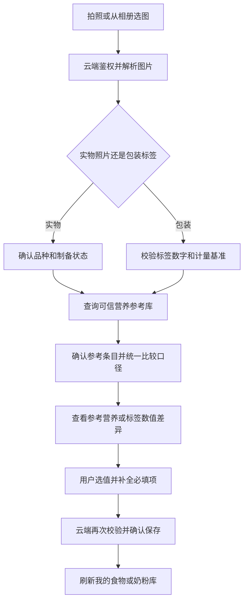

# LemonBabyDairyMini 微信小程序拍照识别接入文档

版本日期：2026-10-12。主模型：`qwen3.7-plus`，百炼北京地域；免费额度耗尽或到期后，自动切换至预先配置的备用模型。

功能：在“添加食物”“添加奶粉”表单中拍照／相册识别，将解析结果与可追溯的营养参考数据比对，由用户核对并选择最终营养值后保存。识别、参考比对、确认保存及两页核对组件已写入 `codex/wechat-photo-recognition` 分支；尚未部署或发布参考数据。端到端流程见第7节，实际配置与验收见第8节。

## 1. 文件接入位置

项目根目录：`/Users/randyhsu_m4/Documents/workspace/MyProjects/LemonBabyDairyMini`。

| 文件 | 改动 |
| --- | --- |
| `cloudfunctions/recognizeNutritionLabel/index.js`，新增 | 鉴权、读取图片、调用百炼、校验与换算、返回结果 |
| `cloudfunctions/recognizeNutritionLabel/package.json`，新增 | 声明 `wx-server-sdk` 等实际使用的依赖 |
| `cloudfunctions/recognizeNutritionLabel/config.json`，新增 | 超时60秒、内存512MB |
| `miniprogram/utils/nutritionRecognition.js`，新增 | 选图、压缩、上传、调用、状态管理 |
| `miniprogram/pkg-milk/food-management/index.js/.wxml/.wxss` | 识别按钮、结果提示、回填 `formData` |
| `miniprogram/pkg-milk/powder-management/index.js/.wxml/.wxss` | 识别按钮、输入同步、回填 `powderDraft` |
| `cloudfunctions/lookupNutritionReference/`，新增 | 根据食物身份查询参考数据，生成同基准比对结果 |
| `cloudfunctions/confirmNutritionRecognition/`，新增 | 用户确认后再次鉴权、校验来源、去重并提交业务数据 |
| `miniprogram/utils/nutritionComparison.js`，新增 | 比对展示、字段选值、分组回填和手动修改状态 |
| `scripts/import-nutrition-reference.js`，新增 | 导入已核验的数据源，生成质量报告并发布参考数据版本 |
| `miniprogram/models/food.js`、`miniprogram/pkg-milk/models/powderCatalog.js`、`miniprogram/utils/formulaPowderUtils.js` | 接入确认保存，保留识别来源、参考版本和缺失标记 |

复用 `miniprogram/app.js` 的 `wx.cloud.init` 和 `app.globalData.cloudEnvId`。图片上传、函数部署与调用使用同一环境。

## 2. 云函数配置

在云开发控制台的识别函数“配置 → 环境变量”中设置：

| 变量 | 值 |
| --- | --- |
| `DASHSCOPE_API_KEY` | 北京地域的百炼普通 API Key |
| `BAILIAN_BASE_URL` | `https://{WorkspaceId}.cn-beijing.maas.aliyuncs.com/compatible-mode/v1`，替换真实业务空间ID |
| `BAILIAN_MODEL` | `qwen3.7-plus` |
| `NUTRITION_FALLBACK_MODEL` | 用户预先选择的备用模型名，推荐候选 `qwen3-vl-flash`；留空时不启用自动切换 |
| `NUTRITION_FALLBACK_BASE_URL` | 备用模型的 OpenAI 兼容接口地址；同一百炼业务空间可留空并复用主地址 |
| `NUTRITION_FALLBACK_API_KEY` | 备用接口密钥；仅在备用地址与主地址相同时允许留空并复用主密钥 |

密钥只放云函数。代码分别从 `process.env` 读取上述变量；缺少配置时返回 `CONFIG_MISSING`，不发起模型请求。Base URL与密钥地域、业务空间保持一致。[官方接入说明](https://help.aliyun.com/zh/model-studio/vision)

主模型配置为必填；备用模型配置为可选。配置备用模型时，必须支持图片输入及本接入所需的结构化输出。备用地址与主地址不同而未配置专用密钥时，禁止向备用地址发送主密钥。备用模型与主模型的地址、模型名组合不能相同。模型、地址与密钥均由云端预先配置，不接受小程序请求传入的任意模型或地址。

推荐备用候选 `qwen3-vl-flash`，支持图片理解及非思考模式下的JSON Object输出；与主模型同属百炼时可复用业务空间接口和密钥，并显式设置 `enable_thinking: false`。营养标签识别准确率仍需使用实际包装图片验证，不因支持图片输入就免除字段核对。[视觉模型说明](https://help.aliyun.com/zh/model-studio/newly-released-models)、[JSON输出支持范围](https://help.aliyun.com/zh/model-studio/qwen-structured-output)

`config.json`：

```json
{
  "timeout": 60,
  "memorySize": 512
}
```

模型调用阶段在代码中设置25秒总时限，主模型与备用模型共同使用该时限；备用请求只使用剩余时间。超时需主动终止底层请求。小程序使用普通事件云函数 `wx.cloud.callFunction`。[微信云函数调用说明](https://docs.cloudbase.net/recipes/add-cloud-function-wechat-miniprogram)

### 免费额度与自动切换

百炼新人额度通常为每个模型100万Token，有效期90天，起算时间为开通百炼、模型发布或模型申请通过三者中较晚的时间；输入与输出共用该额度，不同模型及快照版本的额度独立。实际余额和到期时间以账号控制台为准，不在代码中硬编码100万Token计数或按自然月重置。[免费额度规则](https://help.aliyun.com/zh/model-studio/new-free-quota)、[模型价格与额度](https://help.aliyun.com/zh/model-studio/model-pricing)

切换备用模型不会从切换当天重新获得90天有效期，也不保证备用模型仍有免费额度。启用 `qwen3-vl-flash` 前需在控制台确认其独立额度和到期时间；若主备均要求免费调用，两者都应提前开启“免费额度用完即停”，两者额度均不可用时结束识别并提示。

1. 部署前为主模型开启“免费额度用完即停”，确认配置生效；未开启时百炼会在额度耗尽后转为按量付费，应用无法依靠免费额度错误触发切换。
2. 每次识别先调用主模型。仅当服务明确返回 `AllocationQuota.FreeTierOnly` 时，认定当前免费额度不可用，并自动调用已配置的备用模型。
3. 同一次识别最多调用一次主模型、一次备用模型，使用相同图片与 `requestId`；不递归切换，也不自动重试。备用请求同样必须通过结果校验和单位换算。
4. 超时、网络异常、限流、密钥错误、模型无权限及输出校验失败，均按原错误返回，不作为免费额度耗尽处理，不触发备用请求。
5. 未配置备用模型时返回 `FREE_QUOTA_EXHAUSTED`；备用配置不完整时返回 `CONFIG_MISSING`；备用调用失败时返回其对应错误。所有失败均不修改表单。
6. 备用模型按用户预先选择的计费方式调用；若也要求只用免费额度，需为该模型另行开启“免费额度用完即停”。备用模型可能产生费用，切换配置不能被描述为永久免费。

当前接口返回的 `usage` 表示实际成功模型的本次用量，仅用于追踪，不代表账号免费余额，也不能替代平台的用完即停开关。

## 3. 小程序 → 云函数接口

函数名：`recognizeNutritionLabel`。

### 请求

```typescript
interface RecognitionRequest {
  action: 'recognize';
  sessionId: string; // prepare分配的草稿ID
  requestId: string; // 一次识别操作的唯一ID
  babyUid: string;   // 用于检查现有宝宝访问权限，不传给百炼
  mode: 'food_label' | 'powder_label' | 'food_object';
  fileIDs: string[]; // 当前云环境中上传的图片ID，1～3张
}

interface RecognitionPrepareRequest {
  action: 'prepare';
  requestId: string;
  babyUid: string;
  mode: RecognitionRequest['mode'];
  imageCount: number; // 1～3
  categoryCatalog?: Array<{ value: string; label: string }>; // 食物的本地分类，最多100项供模型参考
  expectedVersion: number; // 奶粉编辑时为当前营养档案版本，旧文档视为0
}
// prepare返回：{ ok:true, sessionId, requestId, filePaths, envId }。
// 必须上传到服务端分配的filePaths，不接受客户端自拟识别图片目录。
```

模式：`food_label` 提取包装食品营养表；`powder_label` 提取奶粉营养表和冲调说明；`food_object` 只识别食物名称、候选品种与可见制备状态，再由参考查询服务检索营养数据，前端展示候选并由用户确认。

### 成功返回

```typescript
interface RecognitionSuccess {
  ok: true;
  sessionId: string; // 云端识别草稿ID，后续匹配、比对和确认保存均引用该ID
  requestId: string;
  mode: RecognitionRequest['mode'];
  identityCandidates: Array<{
    name: string;
    preparation: 'raw' | 'boiled' | 'stir_fried' | 'other' | 'unknown' | 'dry_powder' | 'prepared_formula';
    brand?: string | null;
    series?: string | null;
    stage?: string | null;
    barcode?: string | null;
  }>;
  patch: FoodPatch | PowderPatch;
  observation: object; // 已规范化的基准、营养原值、冲配信息与证据，供客户端同源换算
  classification: {
    category: string; // 分类建议，前端须匹配本地目录或创建后才能选用
    categoryMatched: boolean;
    proteinSource: 'natural' | 'special' | null;
    proteinQuality: 'premium' | 'regular' | '' | null;
    identity: object;
    source: 'model_suggestion';
  } | null;
  missingFields: string[]; // 营养字段名，例如protein；缺失不能当作0
  warnings: string[];      // 单位、计量基准或图片不清晰等提示
  evidence: Record<string, { imageIndex: number; text: string }>;
  originalBasis: {
    quantity: number | null;
    unit: string | null;
    material: 'food' | 'dry_powder' | 'prepared_formula' | 'unknown';
  };
  usage: { inputTokens: number; outputTokens: number };
  modelInfo: {
    requestedModel: string; // 配置的主模型
    actualModel: string;    // 本次实际成功识别的模型
    fallbackUsed: boolean;
    fallbackReason: 'FREE_QUOTA_EXHAUSTED' | null;
  };
}

interface FoodPatch {
  name?: string | null;
  category?: string | null;
  categoryLevel2?: string | null;
  unit?: string | null;
  baseQuantity?: number | null;
  calories?: number | null;
  protein?: number | null;
  fat?: number | null;
  carbs?: number | null;
  fiber?: number | null;
  sodium?: number | null;
}

interface PowderPatch {
  name?: string | null;
  nutritionPer100g?: {
    calories?: number | null;
    protein?: number | null;
    fat?: number | null;
    carbs?: number | null;
    fiber?: number | null;
  };
  mixRatio?: { powder?: number | null; water?: number | null };
}
```

`patch` 为云函数校验后的白名单字段，不是模型原始输出。证据的 `imageIndex` 从0开始，与请求图片顺序一致；缺失值返回 `null` 或省略，不返回虚构数字。奶粉分类与 `proteinRole` 由现有分类流程维护，不直接由模型回填。

### 失败返回

```typescript
interface RecognitionFailure {
  ok: false;
  requestId: string;
  code: 'CONFIG_MISSING' | 'INVALID_INPUT' | 'FORBIDDEN'
    | 'FREE_QUOTA_EXHAUSTED' | 'MODEL_TIMEOUT'
    | 'MODEL_UNAVAILABLE' | 'INVALID_MODEL_RESULT' | 'RECOGNITION_IN_PROGRESS'
    | 'SESSION_EXPIRED' | 'REFERENCE_UNAVAILABLE' | 'COMPARISON_STALE'
    | 'VERSION_CONFLICT' | 'VALIDATION_FAILED' | 'SAVE_FAILED' | 'SERVICE_UNAVAILABLE';
  message: string;
  stage?: string; // 云端记录的失败阶段，不包含用户数据、图片或密钥
}
```

失败时不修改表单。主模型返回 `AllocationQuota.FreeTierOnly` 时，按第2节规则自动调用预先配置的备用模型；未配置备用模型或备用模型也返回该错误时，映射为 `FREE_QUOTA_EXHAUSTED`。只匹配该明确错误码，不能将所有HTTP 403错误当作免费额度耗尽。

### 识别失败诊断

云函数统一日志标签为 `[nutritionRecognition]`，记录 `requestId`、`action`、`stage`、业务错误码 `code`、原始错误码 `sourceCode`、错误类型、最多3个文件名与行列位置；模型接口返回失败时另记录 `httpStatus`。不记录原始异常消息、完整堆栈、请求或响应正文、上传签名、密钥、图片和营养识别原文。

未知异常返回 `SERVICE_UNAVAILABLE`，不能据此判断为模型故障。`prepare_read_session`、`prepare_create_session` 表示草稿读写阶段，`prepare_allocate_images` 表示上传路径分配阶段，这些阶段尚未调用百炼；只有 `model_request` 表示进入模型调用。`model_request` 中HTTP 401应核对密钥、地域与空间权限，404应核对接口和模型名，429表示限流；403仍仅在原始错误码精确为 `AllocationQuota.FreeTierOnly` 时切换备用模型。

用户反馈的旧日志只有 `MODEL_UNAVAILABLE` 与“服务暂时不可用”，原因是旧实现把所有未知异常映射成该错误，无法还原此次失败来源。部署诊断修复后重新识别，再结合日志阶段与原始错误码定位；不先盲目更换API Key。云开发日志行上的状态码表示平台调用状态，不是百炼HTTP响应码。

## 4. 云函数 → 百炼接口

主模型请求：`POST ${BAILIAN_BASE_URL}/chat/completions`。备用模型使用云端解析后的备用地址、模型名和密钥，走相同识别与校验流程；不能只切换请求中的模型名而忽略接口地址与密钥。

请求头：`Authorization: Bearer ${DASHSCOPE_API_KEY}`、`Content-Type: application/json`。

图片由云函数读取并编码为 `data:image/jpeg;base64,...` 或 `data:image/png;base64,...`。不能把微信 `fileID` 或手机临时路径直接传给百炼。

主模型请求体构造如下；备用模型按其实际支持的参数构造请求，不发送不支持的思考控制参数，结构化输出须满足同一数据约定：

```javascript
// imageDataUrls 是云函数读取图片后生成的Base64数据地址数组。
function buildModelRequest(imageDataUrls, prompt) {
  return {
    model: process.env.BAILIAN_MODEL,
    enable_thinking: false,
    stream: false,
    max_tokens: 1500,
    response_format: { type: 'json_object' },
    messages: [{
      role: 'user',
      content: [
        { type: 'text', text: prompt },
        ...imageDataUrls.map(url => ({
          type: 'image_url',
          image_url: { url }
        }))
      ]
    }]
  };
}
```

`qwen3.7-plus` 默认开启思考，因此必须显式传 `enable_thinking: false`。[思考模式配置](https://help.aliyun.com/zh/model-studio/vision)

提示词按 `mode` 生成，至少要求：

- 输出JSON；仅抽取图片可见信息，无法确认的值为 `null`。
- 返回名称、所需营养字段、原始单位、营养计量基准和对应图片文字证据。
- 奶粉区分干粉与冲调液；冲配比区分粉重、加水量、成品体积和每勺克数。
- `food_object` 只返回候选食物名称，不生成营养值。

解析 `choices[0].message.content`，检查 `finish_reason`，拒绝截断、不可解析或字段类型错误的结果。JSON模式不保证数据真实，仍需服务端校验。[结构化输出说明](https://help.aliyun.com/zh/model-studio/qwen-structured-output)

服务端在调用前获取 `cloud.getWXContext().OPENID`，复用现有宝宝访问权限逻辑；校验图片属于允许访问的用户／宝宝路径和当前环境。限制实际图片为JPEG／PNG、单张不超过3MB、最多3张。日志只记录请求ID、模型名、是否使用备用模型、耗时、用量和错误码，不记录密钥、图片或识别原文。

## 5. 单位校验与字段回填

| 识别内容 | 回填目标 | 单位／规则 |
| --- | --- | --- |
| 食物名称、分类 | `formData.name/category/categoryLevel2` | 分类匹配页面已有选项 |
| 食物营养基准 | `formData.unit/baseQuantity` | 保留每100g、每100ml或每份；单位映射为现有表单值 |
| 食物热量 | `formData.calories` | kcal；若包装为kJ，除以4.184 |
| 食物蛋白、脂肪、碳水、纤维 | `formData.protein/fat/carbs/fiber` | g，相对于上述营养基准 |
| 食物钠 | `formData.sodium` | mg，必要时由g换算为mg |
| 奶粉名称 | `powderDraft.name` | 可组合包装上明确的品牌、系列、段位 |
| 奶粉营养 | `powderDraft.nutritionPer100g` | 每100g干粉；热量kcal，其余g |
| 冲配粉量 | `powderDraft.mixRatio.powder` | g，可使用明确每勺克数×勺数计算 |
| 冲配水量 | `powderDraft.mixRatio.water` | 加水量ml，不能用成品体积替代 |

仅有每100ml冲调液营养时，缺少可靠粉重与成品体积就不换算为每100g干粉。g与ml没有可靠密度时不互换。字段缺失与确认值0分别处理。

前端合并 `patch` 时：

1. 只接收白名单路径，非空有效数值转为表单字符串；0保留，`null` 不回填。
2. 默认填入空字段和未被手动修改的上次识别字段；覆盖已有手填值需用户明确选择。
3. 奶粉输入目前主要通过 `e.detail.value` 在提交时读取，需为名称、营养、冲配比增加 `bindinput`，同步 `powderDraft` 并记录修改状态；保留现有输入的 `name` 属性。
4. 回填基准、名称和营养字段应作为一组处理。保留旧营养值时，不能自动改成另一计量基准；冲配粉量、水量也应成组核对。
5. 对照当前 `requestId` 和表单状态，丢弃切换条目或关闭表单后到达的结果。
6. 展示缺失项和核对提示，不自动保存；必填项缺失时补拍，不用0通过校验。

食物保留 `saveFood()` 页面入口；奶粉保留 `savePowderDraft(e)` 页面入口。识别来源的提交按第7节接入云端确认保存，沿用现有业务集合与字段；识别云函数不直接写入用户食物或奶粉。母乳编辑状态不显示拍照识别入口。`food_object` 复用系统食物的加入体验，匹配不唯一时让用户点选。

保留识别证据和缺失标记：当前部分营养归一化逻辑会将空值转为0，展示时不能把缺失项目描述为确认值0。

## 6. 调用与部署顺序

小程序选图、压缩后先申请专属上传路径，再上传并识别：

```javascript
// 以下变量由当前表单、图片数量和版本提供。
const { result: prepared } = await wx.cloud.callFunction({
  name: 'recognizeNutritionLabel',
  data: { action: 'prepare', requestId, babyUid, mode, imageCount, expectedVersion }
});
// 按prepared.filePaths上传图片，得到fileIDs；具体调用封装在nutritionRecognition.js。
const { result } = await wx.cloud.callFunction({
  name: 'recognizeNutritionLabel',
  data: { action: 'recognize', sessionId: prepared.sessionId, requestId, babyUid, fileIDs }
});
```

识别期间禁用重复提交。上传／调用异常及成功返回后均在 `finally` 中恢复操作状态；页面级等待超时只结束界面等待，不等于取消云端请求，因此不自动重试。

1. 三个云函数与小程序分包组件使用的公共模块副本已纳入版本管理，换电脑或新检出后无需先生成这些文件。修改共享源码后执行 `npm run build:nutrition` 同步副本，再执行 `npm run check:nutrition`；将源码和副本一起提交，上传前再次检查一致性。
2. 按第8节配置集合与访问规则；在微信开发者工具选中与 `app.js` 一致的云环境，分别上传三个营养云函数并云端安装依赖。
3. 在该函数配置第2节的环境变量、超时和内存。
4. 在百炼为主模型开启“免费额度用完即停”，确认生效；配置用户选择的备用模型、接口和密钥，核对其图片输入、结构化输出能力及计费方式。
5. 使用模拟模型响应验证：主模型成功时不调用备用；主模型返回免费额度错误时仅切换一次；其他错误不切换；备用未配置或失败时保留原表单；切换全过程遵守25秒总时限。不要通过真实消耗免费额度制造测试条件。
6. 云函数部署就绪后上传小程序体验版，核对图片读取、字段回填、单位换算、实际模型信息和原有保存流程，再按项目发布流程上线。

本接入使用现有云开发环境和普通云函数调用，无需配置小程序直接请求百炼的域名。

## 7. 图片解析、营养参考比对与落库方案

本节中的“比对”指解析结果与官方或第三方营养参考数据比对，不是Excel导入文件之间的差异比对。所有新增集合、接口和字段均为拟实现设计，本次整理不创建集合、不导入生产数据。

### 7.1 先区分实物和包装

| 场景 | 图片中可获取的数据 | 参考数据的作用 | 最终营养值 |
| --- | --- | --- | --- |
| 青菜等实物照片 | 名称候选、可能的品种、可见生熟状态；未知信息保留未知 | 用户确认身份后，查询同品种、同制备状态的营养参考 | 用户确认的参考值，标记为参考数据库来源 |
| 包装食品营养表 | 名称、标签数字、单位、计量基准、对应文字证据 | 同食物或同产品、同口径数据用于展示差异 | 用户核对后的标签值、参考值或手填值，保留各字段来源 |
| 奶粉包装及冲调说明 | 品牌、系列、段位、干粉或冲调液营养、粉水量 | 优先同品牌、系列、段位和版本的厂家或可信产品资料 | 用户核对后的每100g干粉营养与加水冲配比 |

实物照片不能直接给出该份食物的真实营养数值、密度或重量。图片解析不让模型猜测营养值；未匹配到可信参考数据时，符合第9节条件的普通食材自动进入独立的AI缺项估算，其他情况手动补充。奶粉不能用普通牛奶或通用奶粉均值覆盖具体产品的数据。通用参考值属于参考信息，不能据此自动判定标签错误或自动纠正标签。

### 7.2 参考数据来源与发布

推荐采用“云端维护参考数据快照，识别时查询快照”的方案，避免每次识别都依赖外部网站、数据格式和接口响应。

- 国内食材优先使用来源和使用范围已核验的《中国食物成分表》数据。中国疾控中心营养与健康所公布的平台主要基于该表，并明确保留数据版权；已公开查询不等于已有批量接口或再发布授权。[官方平台说明](https://www.chinanutri.cn/yyzyxxpt/sjzx/swcfsjk/201911/t20191128_207183.html)
- USDA FoodData Central 可作为补充来源，支持食物搜索、详情API和数据下载；数据按CC0发布。鲜食材优先匹配分析数据类型，品牌食品保留其厂家标签来源，不将所有USDA条目都视为实验室实测值。[API与许可](https://fdc.nal.usda.gov/api-guide/)、[数据类型说明](https://fdc.nal.usda.gov/data-documentation/)、[数据下载](https://fdc.nal.usda.gov/download-datasets/)
- 其他第三方只接入可追溯、明确使用范围的数据；保存原始记录ID、来源地址、更新时间和版本。模型记忆、随机网页搜索摘要不作为营养参考数据库。
- 现有 `cloudfunctions/migrateSystemFoods/foods.json` 带有 `origin.source = china_food_composition_table`、食物编码和食部比例，可以用于建立映射。该标记本身不证明版本、字段准确性或使用范围已经核验。

参考导入步骤为：读取原始数据 → 按来源映射字段与单位 → 保留缺失状态 → 审查来源和口径 → 输出导入质量报告 → 发布不可变数据版本。每条数据只有完成来源、单位、基准和必需字段核验后，才进入可用于营养回填的参考集合。

当前 `scripts/convert-food-composition-xlsx.py` 的 `to_number()` 会把空值、无法解析的值转为0。建设参考库前必须从原始数据恢复“确认值0”“缺失”“微量/检出限”等状态；无法拿到原始值的历史0标记为未核验，不能猜测修复或用于判定其他数据有误。

### 7.3 数据分层

| 数据 | 拟存放位置 | 职责 |
| --- | --- | --- |
| 营养参考快照 | 新增 `nutrition_reference` | 服务端维护，只读查询；不承载用户食物或喂养记录 |
| 识别与核对草稿 | 新增 `nutrition_recognition_sessions` | 保存解析结果、证据、候选和用户确认前的版本；与用户、宝宝绑定 |
| 用户食物 | 现有 `food_catalog` | 保存最终确认的食物条目或宝宝专属系统食物快照 |
| 用户奶粉 | 现有 `milk_nutrition_profiles.formulaPowders` | 按 `babyUid` 保存共享营养档案中的奶粉条目 |

奶粉主源以当前 `nutritionProfile.js` 实现为准：优先读写 `milk_nutrition_profiles`，`baby_info.nutritionSettings` 仅用于历史设置回退和初始化迁移。本识别链路不新增对旧营养设置集合的并行写入。

参考记录至少包含：`referenceId`、食物/产品编码、规范名称、别名、制备状态、产品身份、营养基准、字段单位、字段定义、每项数值及缺失状态、来源机构、来源地址、数据类型、原始记录ID、数据版本、校验状态。不同来源和不同版本保留独立记录，不按同名强行覆盖；选定参考后固定其版本。

识别草稿包含：`sessionId`、`requestId`、`babyUid`、操作者、模式、图片顺序、模型信息、解析字段与证据、单位换算记录、身份候选、选定参考快照、比对结果、状态和过期时间。未确认草稿24小时过期；过期后需重新核对，成功保存的必要证据随业务条目保留，草稿不成为另一份业务主数据源。

草稿仅允许发起者操作，并在每次调用时复核其仍拥有宝宝访问权限。状态按“已解析 → 已选身份 → 已比对/无可用参考 → 待确认保存 → 已保存”推进；更换身份、参考或计量基准后作废旧比对版本。已保存草稿封存，重复请求返回原保存结果，不通过更换操作ID再次创建业务条目。

### 7.4 端到端流程



1. **选图上传**：生成 `requestId`，选1～3张图片，压缩并上传到当前环境的用户/宝宝专属路径。记录表单会话和条目ID，取消、切换宝宝或关闭弹窗后不接受迟到回填。
2. **识别解析**：云函数校验 `OPENID + babyUid` 绑定及图片权限。模型提取可见信息；主模型免费额度不可用时按第2节切到备用模型，成功后生成识别草稿并返回 `sessionId`。此时不写用户食物、奶粉或喂养记录。
3. **确认食物身份**：实物模式返回名称候选，而非模型推测营养。用户确认具体品种及生熟/制备状态；“青菜”无法唯一对应条目时显示候选，不直接按泛称采用某一条数据。
4. **匹配参考数据**：`lookupNutritionReference` 按身份检索参考快照，先匹配产品编码或已维护的食物编码映射，再匹配规范名称/别名和制备状态。模糊匹配只用于候选排序，不能自动认定同一食物。第三方英文名称使用经维护的中文映射，不能只按模型临时翻译作为唯一匹配依据。
5. **统一口径并比较**：选定参考条目后，云端对草稿中的观察值及参考值进行单位和基准校验，计算可比较字段的差异。不匹配、缺失或口径不明的字段明确标记为不可比。
6. **展示核对页**：显示照片证据、识别值、参考值、计量基准、差异及来源/版本。实物模式显示“参考营养”，不制造不存在的识别数值。用户选择保留标签值、采用参考值或手动修改，必填项缺失时要求补拍或补填。
7. **确认保存**：前端提交 `sessionId`、选定参考ID、字段选择、手填值、目标条目ID及预期版本。云端重新鉴权，读取自身保存的解析与参考快照，生成白名单业务字段后落库；不直接信任客户端提交的“官方值”或来源标签。
8. **刷新结果**：返回已保存条目ID，更新页面列表及现有食物目录失效标记/奶粉档案读取。保存失败保留核对状态；自动刷新参考库不改写已保存条目或历史喂养快照。

服务分工和数据交接：

| 服务 | 请求中的关键字段 | 返回数据 |
| --- | --- | --- |
| `recognizeNutritionLabel` | `requestId`、`babyUid`、模式、图片ID | `sessionId`、身份候选、经过校验的标签字段、证据、缺失项和实际模型 |
| `lookupNutritionReference` | `sessionId`、宝宝、确认后的身份；选定候选时附参考ID | 参考候选、匹配状态、已选参考版本、逐字段比对结果和比对版本 |
| `confirmNutritionRecognition` | `sessionId`、保存操作ID、比对版本、字段选值、手填值、目标ID和预期业务版本 | 保存状态、业务条目ID、最终值及当前业务版本 |

参考查询返回“已匹配”“存在多个候选”“未找到”“参考不可用”等状态，字段另行标记可比、观察值缺失、参考值缺失或口径不一致。包装标签已核对完整但无参考时，允许用户明确采用标签值保存，记录“未完成参考比对”；普通食材缺项可按第9节明确申请AI估算并逐项选用，也可补充可信数据或手填。未完成比对不能显示为“官方校验通过”。

### 7.5 数值比较规则

- 比较前必须是相同食物/产品、相同制备状态和相同营养定义。生、煮熟、炒制食物分别匹配，不将不同状态的数据当成同一标准。
- 食物比较通常统一至每100g可食部分。标签若为每份，只有明确每份克数才能计算 `每100g值 = 每份值 × 100 / 每份克数`；原表单仍可保留其原始计量基准。
- 热量统一为kcal，kJ除以4.184；蛋白、脂肪、碳水和纤维统一为g，钠统一为mg。NRV百分比不能当成营养含量，盐含量不能直接当作钠含量。
- 无可靠密度时，100ml与100g不可直接比较。奶粉只有干粉基准可信，或粉重和成品体积均有可靠依据时才换算；加水量不等于成品体积。
- 跨来源比较碳水、纤维、热量等字段前核对其定义和计算口径；定义不一致或未知时提示口径差异，不据此判定数字错误。
- 两个值均有效且口径一致时，计算 `差值 = 观察值 - 参考值`；参考值大于0时计算 `差异百分比 = 差值 / 参考值 × 100%`。参考值为0时只显示差值，不除以0。
- 缺失值不参加差异计算，确认值0正常参与。使用原始有效精度计算，展示时再取舍小数。
- 差异只作为核对信息；不存在本方案认定的通用“超过某百分比就一定识别错误”规则。需要异常提示阈值时，按来源、食品类型和字段配置并用真实样本验证，不作为强制覆盖依据。

### 7.6 用户选值和来源追踪

数据始终保留三层：**解析原值及证据**、**选定参考版本的值**、**用户最终确认的值**。核对页上的修改不能反向改写解析证据或参考记录。

最终选择按字段记录 `label`、`reference`、`manual`、`model_estimate` 来源；实物模式的参考建议值来自用户选定的参考条目。AI估算单独展示，点击生成不会回填；用户逐项点击估算值后才采用。包装或奶粉缺失项采用参考值必须由用户选择，并满足同产品和同口径条件，不自动用通用均值补齐。

名称/身份、计量基准和营养值作为一组处理；粉重与加水量作为一组处理。用户选择不同身份或不同基准时重新生成核对结果，不将旧营养数值拼到新食物或新基准下。回填只填空字段或未被修改的上次识别字段，手动覆盖需用户明确选择。

食物和奶粉的最终业务条目附带 `recognitionMeta`：请求/会话ID、实际模型、选定参考来源/记录ID/版本、原始基准、已确认字段来源、必要文字证据、缺失标记及确认时间。该元数据在读写、归一化和必要的食物快照中保留；不得仅添加在页面草稿后被 `normalizeFormulaPowders()` 丢弃。

核心必填营养缺失时不能用0完成保存。可选项目未识别时保留缺失标记，展示和后续比较不能把计算层的默认0解释成已确认含量为0。旧条目缺少元数据时沿用旧条目显示，并标明未经本识别流程核验，不伪造来源或补写证据。

### 7.7 确认落库与一致性

- `confirmNutritionRecognition` 检查草稿未过期、用户/宝宝可访问、参考快照与确认页版本一致、字段属于白名单、数值有效、基准可用及必填项完整。
- 用户新食物写入 `food_catalog`，保持 `babyUid`、所有者、共享宝宝和营养基准等现有字段。来自系统食物的条目创建或更新宝宝专属快照，不修改公共系统食物。
- 用户奶粉写入 `milk_nutrition_profiles` 的目标 `formulaPowders` 项，保留同档案中的其他奶粉、母乳数据与生命周期字段；类别和 `proteinRole` 仍由现有分类流程决定。
- 用 `sessionId + 保存操作ID` 记录保存结果，在事务中同时提交业务条目和草稿的已保存状态。重复点击或网络重发返回同一结果，不再次新增食物或奶粉；保存失败不提前标记成功。
- 事务放在服务端，按CloudBase服务端SDK支持的事务能力实现，并在确认保存函数中声明实际使用的SDK依赖；不在小程序端模拟多文档事务。[事务操作说明](https://docs.cloudbase.net/database/transaction)
- 编辑时比较确认页读取的条目/档案版本，其他监护人已修改则提示重新加载后核对，不用整份旧档案覆盖最新数据。同一集合的其他保存入口也需采用一致的版本校验，不能仅给识别入口加检查就声称已解决所有并发覆盖。
- `saveFood()`、`savePowderDraft(e)` 保留为页面保存入口，模型层将识别来源提交交给云端确认保存，沿用现有数据结构和成功后的刷新流程。
- 识别草稿、参考数据和业务数据分别设置访问范围。过期草稿与上传图片按明确的保留规则清理；清理失败不改变已确认业务条目，业务条目不依赖临时图片URL。

### 7.8 “青菜”示例与实现顺序

用户拍摄一份青菜 → 模型返回“青菜/小白菜等候选”及无法确认的状态 → 用户确认具体品种和生熟状态 → 参考服务定位对应食物编码和版本 → 展示每100g可食部分的营养参考 → 用户核对名称、基准和营养来源 → 保存到该宝宝的我的食物库。

该路径不会声称照片里这份青菜的蛋白、热量经过实测。若图片同时包含包装营养表，则另行提取表中数字，与相同口径参考值展示差异，再由用户决定采用哪一组或哪些经确认的值。

实现顺序按依赖推进：

1. 建立参考数据来源适配、规范字段、版本和导入质量报告，处理现有数据中缺失与0混淆的问题。
2. 实现图片解析和识别草稿，加入主/备用模型选择、证据和单位校验。
3. 实现身份匹配、参考候选、同口径比较和失败状态。
4. 在两个页面接入核对与选值，奶粉补齐输入同步，处理手填保护与过期请求。
5. 实现云端确认保存、来源元数据透传、防重及版本冲突检查，对齐现有食物和奶粉主数据源。
6. 验证同名异物、生熟差异、每份与100g、g与ml、NRV误读、缺失与0、参考值为0、奶粉粉水比例、额度切换、重复提交、多人编辑和保存失败。真实包装样本用于评估识别和匹配效果，模拟服务错误用于验证费用与降级路径。

## 8. 当前实现与上线准备

### 本地构建

共享源码位于 `packages/nutrition-recognition-core`，三个云函数及小程序分包组件的 `lib/core` 共 39 个部署副本也纳入版本管理，新检出即可取得这些依赖。修改公共逻辑时只编辑共享源码，运行 `npm run build:nutrition` 同步副本，再运行 `npm run check:nutrition`，将源码和副本一起提交；不要直接修改副本。食物幂等键同步到 `miniprogram/utils/nutritionHash.js`。云函数只加载上传目录内的模块，小程序模块不包含 Node 服务端代码。上传前运行一致性检查；仅拉取完整提交、不修改源码时无需重新生成这些文件。

两页共用 `pkg-milk/components/nutrition-recognition`。每次打开表单递增formSessionId，关闭或切换宝宝后使迟到响应失效。已有手填不自动覆盖；标签/参考按表单当前基准换算，改基准需重新核对。独立弹窗只回显表单所需的粉量和加水量；成品体积继续保存在标签证据中，用于服务端换算，不能替代加水量。

prepare额外接收食物targetId/sourceSystemFoodId，返回识别时冻结的targetFoodId/targetFoodVersion。同宝宝的同系统来源复用已有条目，新快照使用确定ID。奶粉expectedVersion是整份主档案版本；没有新版档案时保留旧母乳、所有旧奶粉及生命周期后再保存目标项。初始化只允许创建，不能覆盖并发建立的档案。

识别图片在prepare时通过服务端获取上传元数据，文件ID与专属路径先记入草稿；上传令牌、签名不会返回客户端。即使取消或模型失败，清理工具仍能定位图片。旧草稿缺少完整图片登记时列入incompleteSessionIds，保留记录等待核对。

### 参考数据导入

支持 `china_food_table`、`usda_fdc`、`manufacturer`、`verified_catalog` 四种provider。厂家及第三方统一JSON格式见 [格式示例](examples/nutrition-reference-format.json)。示例字段均为缺失且verified=false，不能发布为实际参考。不要用模型补齐参考数据。

默认导入仅输出records/rejected/report，检查名称及维护的别名、制备状态、产品品牌/系列/段位、营养定义、单位、计量口径、来源版本和使用范围。旧中国食物表转换器的未知0不自动视为有效0；USDA品牌数据需核验营养口径。必需字段缺失、来源未核验或口径不明的记录不会进入有效结果。

仅在确认授权后使用 `--publish --env` 发布；必须提供真实source-url、version及 `--usage-verified`，且无拒绝项。已发布同一referenceId不能覆盖营养、身份、基准或来源，修订必须新建版本。泛称只供查找候选；模型生成的共同别名不能证明同一食物，奶粉缺少完整产品身份或可靠编码时不自动匹配。

### 集合、访问规则及索引

新增nutrition_recognition_sessions及nutrition_reference，均设置客户端read=false/write=false，通过鉴权后的云函数访问。服务端每次检查当前OPENID在baby_creators或baby_participants中与babyUid的绑定；会话还检查发起人及过期时间。

首次接入必须先在与小程序、云函数一致的云环境中手动新建这两个集合。当前 `app.js` 配置的环境为 `prod-7g5lap9xcf106dbf`；若已调整环境，以实际调用的云函数环境为准。控制台选择“仅管理端可读写”，或使用以下自定义规则；后台云函数继续负责检查用户与宝宝权限。[集合权限说明](https://docs.cloudbase.net/database/data-permission)、[安全规则示例](https://docs.cloudbase.net/rule/rule-example)

```json
{
  "read": false,
  "write": false
}
```

`nutrition_recognition_sessions` 无需手工添加记录，准备流程会创建草稿；`nutrition_reference` 可以先建立空集合，但标准营养参考仍需另行核验并导入。创建集合不等于已有真实营养数据，也不需要为这一操作更换百炼密钥。

若日志显示 `stage=prepare_read_session`、`sourceCode=DATABASE_COLLECTION_NOT_EXIST`，表示识别草稿集合尚未建立或建立在其他环境，本次尚未调用百炼。不要把“集合不存在”当成普通“文档不存在”吞掉，也不要在每次识别请求中自动修改生产数据库结构。

业务集合沿用food_catalog和milk_nutrition_profiles。上线前须在现有宝宝访问规则中同时约束业务版本：新建version=1，更新为读取版本+1，旧缺版本文档按0处理；旧客户端不带版本的整份更新须被规则拒绝。云端事务仍显式校验版本与宝宝身份。未完成这些规则及旧写入口切换前，不开放并发识别保存。

建议索引：nutrition_reference的status/source.verified/searchTerms及status/source.verified/identity.barcode；food_catalog的babyUid/sourceSystemFoodId；milk_nutrition_profiles的babyUid；会话expiresAt供人工导出及过期清理。具体索引按云控制台查询建议核对后建立。不要给保存草稿配置会先删记录的TTL，否则会丢失图片清理依据。

清理命令默认只预览：`node scripts/cleanup-nutrition-recognition.js --input "sessions-export.json"`。实际清理需另行确认后添加 `--apply --env`，会回读最新草稿并核对环境，图片删除失败保留草稿，不操作业务条目。

### 确认保存与验证边界

lookup请求为action/search或select，包含sessionId、babyUid、identity、targetBasis及可选referenceId；返回referenceCandidates、selectedReference、comparison和comparisonVersion。参考服务不可用时返回unavailable状态，仍可核对标签或手填，不能描述为官方校验通过。

confirm请求包含sessionId、operationId、babyUid、comparisonVersion、expectedVersion、targetId、来源系统ID、targetBasis、decisions及form。decisions仅允许六种营养字段，source为label/reference/manual/model_estimate；仅手填附value，其余从服务端草稿取值。奶粉可附mixRatioDecision.source=label，云端按自己的标签证据取粉水量，不相信客户端替换的标签数值。最终名称必须与已确认身份一致；更换身份或计量基准需重新比较。

最终业务条目保留原始营养、基准和冲配证据、参考快照与版本、每个最终字段来源、缺失标记及确认人。普通编辑明确填0会移除缺失标记；清空则恢复缺失，列表用“--”展示。手工改名称使原比对状态失效，原始证据继续保留。

本次未提交、推送、配置云环境、发布参考或部署，未调用真实模型及生产数据接口。本地检查、离线验收和独立审查修复记录见 [验收记录](verification/nutrition-recognition.md)。微信开发者工具、真机与云端权限/索引/事务仍须在获授权的部署环境验收。

## 9. 普通食材AI营养估算

2026-10-13扩展：食物管理添加／编辑弹窗点击「拍照填写营养」并拍照或选图后，打开独立识别弹窗，自动串联图片解析、营养参考查询和普通食材缺项估算。名称与原值冲突、名称不具体、生熟不明或多个参考条目需要选择时，暂停核对，确认后自动继续。只有标签和已选可信参考都无可采用数值的指标才能估算，真实0仍是有效值。奶粉、母乳、特医、明确品牌／系列／段位／条码的产品和“青菜”等泛称不开放通用估算。

标签、已选参考和AI估算按此顺序提供字段建议，已有手填保留，可明确点击「采用推荐」替换。用户核对必填、选填内容及简短来源，点击一次「使用结果」回填外层表单，再通过原保存按钮落库；取消不改变原表单或此前已采用会话。分类和蛋白来源匹配本地选项后提供建议，已有选择保留，具体规则见第10节；缺少核心必填值时仍需补填。普通食材的当前生熟状态持续显示，可修改并重新核对。

估算固定按每100g可食部分提供，可缩放到表单克数基准，不估计照片重量、不在缺少密度时换算g和ml。弹窗集中显示「来自AI估算」，不逐字段展示来源或手填标签，不展示原始JSON、用量、模型内部信息、证据全文或差值面板。完整来源和估算记录继续由服务端保存，不能称为官方标准营养或已完成参考核验。

识别云函数新增按需操作：

```js
wx.cloud.callFunction({
  name: 'recognizeNutritionLabel',
  data: {
    action: 'estimate',
    sessionId,
    babyUid,
    requestId,
    comparisonVersion
  }
})
```

身份和基准不从本请求取值；服务端读取已核对草稿并冻结比较版本。成功结果包含 `estimate`、`comparisonVersion` 和 `cached`；estimate保存source=model_estimate、每100g基准、身份、字段营养、假设、模型、usage、generatedAt和estimateId。相同比较版本重复请求复用结果；并发任务拒绝重复启动。同一次失败请求复用失败结果，用户主动重试使用新requestId。

保存时decision为 `{path:'protein',source:'model_estimate'}`，服务端重新检查资格、身份、基准及比较版本，从自身估算快照取值，忽略客户端伪造的value。业务条目保存 `recognitionMeta.fieldSources` 和 `recognitionMeta.modelEstimate`（含adoptedFields），食物列表显示「含AI估算」。选用后按现有营养统计流程计算；估算来源随食物快照保留。普通手填覆盖的字段改为manual，未改的字段继续保留来源。

摄入记录和食谱原料快照保留已定义的识别元数据，目录后续编辑不改变历史快照。普通编辑未触碰营养字段时，即便表单只展示两位小数，保存仍保留原精度和来源；明确手填覆盖才改变来源。modelEstimate.adoptedFields是原确认时记录，当前仍采用的字段查看fieldSources。普通编辑改名会标记原核对失效，需重新核验数值。

在当前核对表单中更改名称、制备状态、营养基准或参考会清除估算及已采用的估算值，保留手填值；重新查参考后才可生成。关闭弹窗或切换宝宝会隔离迟到响应；云端参考重新核对会清除旧估算，旧请求不能写进新版草稿。

本轮按用户选择采用真实调用阶段回显：准备、上传、图片识别、查找营养参考、补充营养指标、结果已准备。每步完成后更新弹窗，不是逐token流式。失败时可点击「重试未完成步骤」：估算失败复用识别和参考；识别响应网络中断或仍在处理中时复用原会话取回缓存，只有云端明确返回识别终态失败或草稿过期才重新准备。奶粉入口自动回显标签／可信参考及粉水量，不调用普通食材估算；母乳隐藏入口。

无需新增云变量、API Key或数据库集合。估算使用已有DASHSCOPE_API_KEY、BAILIAN_BASE_URL、BAILIAN_MODEL及可选NUTRITION_FALLBACK_*配置；主备共享25秒，只在明确免费额度耗尽／到期错误时切换一次。首次接入估算时，构建共享模块后同步上传recognizeNutritionLabel、lookupNutritionReference、confirmNutritionRecognition三个函数并选择云端安装依赖；只更新识别函数会遗漏估算失效及确认保存规则。这次自动弹窗调整只改小程序与文档，已经部署完整估算版本的环境重新编译小程序即可，无需新增HTTP云函数或升级基础库。

本地检查采用合成模型输出，未调用真实Qwen估算、发布参考或部署。估算准确性需使用真实食材、标签和可信来源逐项验证；本地流程通过不代表营养数字已核验。

若首次估算日志为estimate_save/DATABASE_REQUEST_FAILED，随后出现estimate_claim/RECOGNITION_IN_PROGRESS，检查是否已部署2026-10-13的整体字段更新修复。旧版本把estimate和estimateFailure先设为null，普通对象update会被SDK拆成子字段更新，结果和失败状态都无法保存。修复使用db.command.set替换完整字段，参考查询的selectedReference也采用相同规则。当前代码已重新构建；更新recognizeNutritionLabel和lookupNutritionReference后，对此前已经结束的失败任务重新查找参考，再生成估算。不要为此删除业务数据或更换密钥。

## 10. 本地分类与蛋白类型建议

2026-10-13补充：prepare接收`categoryCatalog`，元素为`{value,label}`，包含页面默认分类、自定义分类及已有食物分类；最多100项用于模型上下文，前端完整分类目录不裁切。目录随识别草稿冻结，后续图片解析和文字估算复用相同目录，不新增模型调用。

图片识别响应的`classification`、文字估算响应的`estimate.classification`与营养参数同时返回，例如：

```json
{
  "category": "蔬菜类",
  "categoryMatched": true,
  "proteinSource": "natural",
  "proteinQuality": "regular",
  "identity": { "name": "上海青", "preparation": "raw" },
  "source": "model_suggestion"
}
```

这是模型分类建议，不是营养实测值。服务端规范枚举并绑定食物身份；前端按当前本地目录再次匹配，优先采用名称／value精确匹配，再采用明确定义的分类别名。例如“蔬菜”可唯一映射到“蔬菜类”；有多个可匹配项时不自动选择，未知分类不能冒充已有项。未匹配时提示「本地暂无此分类」，用户可选已有分类，或编辑建议名称并点击「创建并选用」。创建失败不选中；成功复用`food_categories`当前宝宝目录，只更新分类列表，父表单仍须点击使用结果才回填。创建分类是独立操作，取消识别不会删除已经创建的分类。

- 天然蛋白（优质）：`proteinSource=natural`、`proteinQuality=premium`。
- 天然蛋白（普通）：`proteinSource=natural`、`proteinQuality=regular`。
- 特殊蛋白：`proteinSource=special`、`proteinQuality`为空；只显示建议，由用户明确采用或选择。

蛋白类型依据食材／明确产品及成分知识建议，不根据蛋白克数或为0判断。合法天然蛋白建议在未选择时预选；已有／用户手选项保留，可在蛋白来源选择框自行调整。无法判断或非法枚举保持未选，不能默认当普通蛋白。图片建议特殊蛋白但尚未确认，或用户已经选择特殊蛋白时，不自动调用通用估算；核对标签／产品资料或手填缺项。用户明确改为天然蛋白后会继续符合资格的普通食材估算，已由具体产品身份判定为奶粉／特医等的拒绝规则仍有效。普通食材的文字估算禁止建议特殊蛋白。改名后不匹配的旧自动建议清除；取消／切换宝宝隔离迟到结果。奶粉继续使用固定本地分类及其蛋白角色，不创建任意奶粉类型。

本次需上传更新后的`recognizeNutritionLabel`云函数（包含sessionRepository、modelClient及已构建的lib/core），选择云端安装依赖，并重新编译小程序。已有完整估算环境的lookupNutritionReference和confirmNutritionRecognition业务规则未改；首次接入仍按第8／9节同步三个函数。API Key、Base URL、模型及集合配置沿用现有值；无需新增变量或集合。构建本地已完成，部署副本随 Git 保存；共享源码修改后仍需执行 `npm run build:nutrition` 并一同提交副本。旧识别草稿缓存没有分类建议时，重新拍照／选图生成新草稿。

## 11. 渐进模块、日常分类推荐与界面整理（2026-10-13版本）

2026-10-13后续优化：顶部固定三个真实步骤「上传图片／识别食物（奶粉为识别标签）／补充营养」，图片区、基本信息、营养指标分别展示等待、处理、完成、确认及失败状态。上传显示实际已完成张数；识图尚未返回时显示骨架，返回后才展开名称、分类、生熟和蛋白类型。查询参考及估算在营养模块显示独立加载提示，只有等待自动补充的空字段使用骨架；已有手填、标签／参考数字及真实0保持可见。暂停、失败不继续转圈，重试只加载未完成步骤。参考查询失败需重试取得核对版本；估算失败可保留已经完成的核对并手填缺项。

分类不再只依赖文字相同：精确／明确别名优先，未匹配时结合食材与日常分类语义，对实际本地选项排序。例如山药识别为「薯类、淀粉及制品」，可优先选择「主食及谷薯」，提供「蔬菜类」「蔬菜类及制品」备选；只有后者存在时也可复用。山药淀粉、粉制品、薯片等不套用完整薯类的鲜蔬菜规则。同分候选由用户选择，已有手选保留；没有合适的本地候选才提供默认收起的新建入口。推荐及选择本地候选不额外调用模型，也不自动新建分类。

弹窗沿用项目暖米色与柠檬黄、原生中文字体；标题、模块标题、字段标签、单位及来源统一层级。基本信息与营养分组，计量基准及全部必填／选填营养集中展示，来源采用简短标签，详细来源仅在模块底部简述。识别后收紧图片区，奶粉冲调比例与营养同组。底部取消／使用结果固定，保留滚动和安全区；动画仅用于等待状态及内容出现，减少动态效果设置下停止动画。仍为阶段回显，不是逐token流式。

本轮改变小程序及本地分类推荐，共享构建已执行；已有第10节云端分类返回的环境重新编译小程序即可，无需再增加云函数、变量或改API Key。修改共享源码后需重新构建并一同提交副本，新检出无需再生成这些文件。静态HTML样式预览与合成流程检查不代表微信实际渲染或营养准确性已经验收。

## 12. 识别弹窗复用添加表单（2026-10-14）

当前界面以本节为准。第三步改为「识别营养」，可见的营养内容仍来自标签解析、可信参考及普通食材缺项估算，后台流程没有合并为单次模型请求。

弹窗改用添加页相同的底部弹窗、单列标签与输入框、必填／扩展信息、暖色表单背景及底部取消／使用结果。名称、分类、记录单位、营养基准份量、热量、蛋白、蛋白来源、脂肪、碳水按现有食物添加顺序排列；膳食纤维与钠集中放扩展信息。奶粉保留每100g基准、五项营养及粉量／加水量，不出现普通食材状态或蛋白来源选择。

去掉双列指标卡片、逐字段来源／手填标签、逐字段采用建议及重复来源说明，仅在仍采用AI营养时显示一处「来自AI估算」。改成手填不会增加行内说明或改变行高；已有手填继续保留，全部AI字段改手填后该标识消失。来源、手填决策及确认保存协议仍完整保留在程序与服务端。

生熟状态用于避免把不同制备状态的每100g营养参考混用，默认不展开、不额外要求点击。只有普通食材状态不明确、需要确认才自动展开；也可点击名称下「调整识别」主动修改。修改状态清除旧自动营养建议，重新核对／估算并收起选项，保留手填内容。选择自行手填后解除生熟确认。

上传及识图期间显示缩略图、实际上传计数与等待／加载；识图完成即回显表单，查参考／估算期间只对待补充的空指标显示骨架与转圈。完成后移除缩略图和重复状态文字。失败信息及重试放在滚动区开头，避免藏在长表单末尾。关闭按钮使用两条固定线绘制，触控区域至少44px，不依赖乘号字形和原生按钮行高。

本轮仅改小程序组件与文档；重新编译小程序即可，无需执行build:nutrition、更新云函数或更改API Key／云变量。本地check:nutrition已确认现有共享产物一致。静态HTML预览包含原生按钮默认样式近似，仍不能替代实际微信渲染，由用户自行验收。
