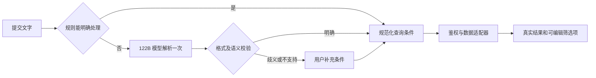
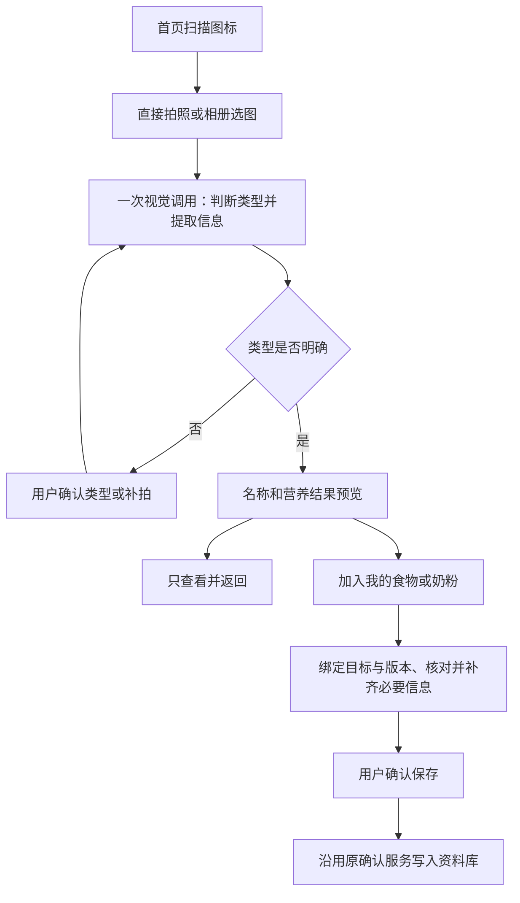

# 首页搜索与智能扫描设计

日期：2026-10-14。状态：设计已确认，本地实现及独立审查完成；尚未部署、实测真实模型或完成微信真机验收。

本文保留已确认的目标行为与实现边界。实施结果与环境待验收项见[验收记录](../../verification/2026-10-14-home-search-scan.md)，云端准备见[部署清单](../../verification/2026-10-14-home-search-scan-deployment.md)。未修改实际云端配置、数据库结构或权限，未提交、推送或部署。

## 1. 已确认的产品决策

| 决策 | 用户确认结果 |
| --- | --- |
| 首页入口 | 弱化原公告横幅，在原位置放搜索通栏，右侧提供独立扫描图标 |
| 首版搜索范围 | 功能入口、食物、奶粉、食谱、历史饮食记录 |
| AI 范围 | 自然语言转搜索条件；食物和奶粉图片识别。项目文档等不接入 |
| 扫描起点 | 直接拍照，由系统判断类型，识别后再核对 |
| 扫描结果操作 | 查看、核对，可选择加入食物或奶粉库；不直接记录本次食用 |
| 历史营养判断 | 使用当时食用记录保存的营养数据，不用当前资料静默替换 |
| 食谱营养筛选 | 支持名称和配料搜索，首版不参与严格的每 100 克营养值筛选 |
| 模型分工 | 搜索采用 qwen3.5-122b-a10b；识图保留 qwen3.7-plus；备用候选 qwen3.5-plus-2026-02-15 |
| 成本方向 | 优先使用用户已持有的免费额度，搜索与识图独立配置和计量 |
| 测试约束 | 默认不新增、修改或扩充单元测试；实施阶段执行适当静态检查、构建、既有检查与手动验收 |

功能范围、扫描后的操作、历史营养依据、自动识别流程以及食谱筛选口径均已由用户明确选择。其余标为“设计推荐”的交互默认值和工程参数留在本文中供整体审阅，不扩大上述业务范围。

## 2. 目标、范围与完成标准

用户可以从首页完成两件事：输入名称或一句话，查到有依据的站内结果；拍摄食物或包装，查看名称和营养信息，并在主动确认后加入自己的资料库。

首版结果必须能回到真实资料或原始记录，显示所属宝宝、时间、计量基准及必要的数据来源。AI 负责理解输入，权限、查询、数值换算与保存由代码执行。

本期不包含：用药、睡眠、排便、成长日记、报告全文或指标搜索；项目文档、知识库、联网问答；自动饮食建议；自动创建食用记录；条码专用扫描和外部商品库接入；新建食谱成品重量体系；向量数据库与训练模型。

既有普通食材 AI 营养估算仅按现有资格和用户显式操作保留，不因首页扫描而自动执行；奶粉、特医食品及明确品牌产品继续禁止通用估算。

## 3. 首页与搜索页交互

### 3.1 首页通栏

- 搜索通栏替换原跑马灯占位，保留宝宝卡、今日统计与快捷记录的层级。
- 左侧搜索图标，中间“搜索食物、记录、功能”，右侧扫描图标；扫描为独立点击区，不触发搜索页。
- 点击搜索区域进入独立搜索页并聚焦输入；点击扫描进入独立扫描页，并在首次进入时启动相机选择器；取消拍照后保留“重新拍照／从相册选择”。
- 首次授权按系统相机权限流程处理，拒绝时仍可选相册；不循环弹出授权或相机。
- 设计推荐：公告缩为通栏下方的“查看更新”小字入口，点击查看完整内容。沿用已有 visible/text 配置，不新增公告发布系统。按账号与公告内容摘要保存已读状态，有新内容才显示未读标记；公告关闭时不显示入口。

### 3.2 搜索页

- 顶部输入框、清除、提交和扫描入口；明确显示“当前宝宝：名称”。
- 分类为“全部／功能／食物／奶粉／食谱／饮食记录”。全部页按类别分组，每类先展示少量结果，查看更多进入对应分类。
- 输入过程中只做本地功能匹配和已有缓存的名称建议；不随每个按键调用 AI。
- 提交后，精确功能名、明确分类筛选、简单名称搜索走规则；带日期、比较、吃过/喝过等关系的表达进入 AI 解析。规则无法确认含义时也进入解析，不能凭少量触发词把复杂语句当普通名称。
- 简单查询无结果时提供“按描述智能搜索”，允许用户主动覆盖规则分流。
- AI 解析后先显示可编辑条件标签，再自动查询；不要求每次确认。存在歧义时，显示要补充的条件，用户选择后再查询。
- 首版筛选支持类别、资料来源、日期和营养条件；营养条件初期采用条件之间全部满足的 AND 语义。不支持的 OR、嵌套条件、医疗判断等须说明并让用户改写，不能静默丢弃。
- 用户修改已解析的筛选项只重新查询，不再调用模型。修改原句并提交才重新解析。
- 结果卡显示类别、名称、来源；饮食记录额外显示日期、实际食用量、命中摘要和营养基准。点击进入资料预览或对应原记录。
- 结果返回、切换分类时保留关键词、条件与滚动位置；切换宝宝、退出账号、权限失效时清理当前私有结果与缓存。
- 设计推荐：最近搜索最多 10 条，仅本地按账号和宝宝隔离，可逐条或全部清除，不制作全站热搜。

### 3.3 查询范围与排序

| 类型 | 首版匹配字段 | 默认展示与跳转 |
| --- | --- | --- |
| 功能 | 页面名称、业务关键词、维护的常用别名 | 精确匹配优先，仅显示当前角色可访问入口；进入原页面 |
| 食物 | 名称、别名、代码、分类；六项已知营养值 | 我的资料与系统资料分来源；预览后可打开对应管理页面 |
| 奶粉 | 名称、品牌、系列、段数、别名、分类；已知营养值 | 明确干粉／冲调液基准，不混合比较 |
| 食谱 | 名称、备注、配料名称 | 查看配料及食谱详情，不参与严格的每 100 克营养值筛选 |
| 饮食记录 | 历史食物或奶粉名称、餐次、备注、日期及历史营养快照 | 时间倒序，展示实际摄入；可定位餐次或喂奶记录 |

“全部”中的资料按精确名称、别名、部分匹配排序；同等级稳定按名称和 ID 排序。“饮食记录”按日期、时间、原记录 ID 排序。排序规则由代码确定，模型不参与打分。

设计推荐：没有时间条件的饮食检索默认显示明确可见的“近 30 天”筛选标签，用户可改为自定义日期或全部历史。模型解析出时间条件时覆盖默认值。不能暗中以近期缓存代表全部历史。

## 4. 自然语言查询协议

### 4.1 支持的意图

`navigate_feature`：查找功能；`search_catalog`：查询食物、奶粉、食谱资料；`search_diet_records`：查询饮食明细；`find_consumed_foods`：从实际食用明细找出符合条件的食物。

本期不实现自由问答或任意统计分析。普通名称可同时查询资料与饮食记录；关系查询按解析出的明确类别执行。设计推荐：“吃过的食物”覆盖独立食物和食谱食用条目，“喝过的奶粉”单独匹配奶粉组分；食谱模板中出现的配料不能据此宣称宝宝已单独吃过。

模型响应为严格白名单对象，版本为 `schemaVersion: 1`。不允许生成任意 URL、集合名、数据库语句、正则表达式、宝宝 ID、用户 ID、代码或写入动作。额外字段、错误枚举、超长内容都由服务端拒绝。

例如“找上周吃过、每100克蛋白质低于1克的食物”：

```json
{
  "schemaVersion": 1,
  "status": "ready",
  "intent": "find_consumed_foods",
  "scope": ["food"],
  "keyword": "",
  "period": {"kind": "previous_calendar_week"},
  "conditions": [{
    "field": "protein",
    "operator": "lt",
    "value": 1,
    "unit": "g",
    "basisQuantity": 100,
    "basisUnit": "g"
  }],
  "sort": "latest_consumption"
}
```

`status` 只允许 `ready / needs_clarification / unsupported`。后两种不得执行不完整查询。数值操作符只允许 `lt/lte/eq/gte/gt`，营养字段只允许 `calories/protein/fat/carbs/fiber/sodium`，首版最多 6 个条件，关键词最多 100 字符，原句最多 300 字符。

“低蛋白”“最近”“这个月喝得少”等未给出可确定口径的表达，应返回需要补充的条件。明确“上周／最近 7 天／本月”由程序按定义处理，不让模型凭空设阈值。

### 4.2 解析与执行分开

新增云函数 `searchManager`，通过白名单 action 承接站内搜索：

- `capabilities`：返回功能开关、当前账号可用范围、AI 是否可用及额度状态，不返回密钥。
- `interpret`：接收 `requestId/query/babyUid`，鉴权后解析自然语言，返回已校验条件和使用模型；不把任何完整宝宝历史发送给模型。
- `execute`：接收 `queryPlan/babyUid/cursor/pageSize`，再次鉴权和校验条件，解析相对日期并执行适配器查询。手动筛选也使用同一入口。
- `preview`：按白名单类别与来源 ID 查询单条资料，服务端校验所属宝宝或系统资料可见性。

客户端传来的 babyUid 只是目标提示，必须用云端登录身份检查创建者／参与者绑定。服务端不接受客户端自报身份、角色、额度或权限。

无需工具调用后的第二轮模型总结：合法参数由代码执行，页面直接展示结果。首版采用 JSON 输出即可；以后改为 Function Calling 也不能跳过参数校验。



## 5. 历史数据、营养语义与分页

### 5.1 时间与摄入

- 统一使用 `Asia/Shanghai`，周一为一周起点。“上周”是上一完整日历周，“最近 7 天”包含今天，与上周不同。
- 以 2026-10-14 为例，上周为 2026-10-05 至 2026-10-11；内部采用开始含、结束不含的边界，结束为 2026-10-12 00:00。
- 日期条件绑定记录所属业务日期；时间戳与日期字段混用时由适配器统一，不能直接使用云函数机器本地时区。
- “吃过”要求未删除且实际 `quantity > 0`。`plannedQuantity/plannedNutrition` 不参加，已经折算的实际数量不再乘 `completionPercent`。
- 奶粉部分喝完记录使用实际 `formulaComponents`；`preparedComponents` 表示冲配原量，不作为实际摄入。
- 同一食物不同日期的营养快照不同时，只纳入条件成立的那些记录。历史“吃过的食物”结果按稳定食物身份合并已加载命中，并保留各次依据；不把不同品牌、段数、生熟状态只按同名强行合并。

### 5.2 营养值三态

统一查询层保留 `known / missing / not_convertible`，并保留来源为标签、参考、手填或用户已采用的 AI 估算。已确认的 AI 估算可在历史记录中展示和检索，但必须标注来源，不升级为标签实测。

- 明确标签的真实 0 可比较；空值、微量、低于检测限不能视为 0。
- 查询必须在原始字段被默认值归一化之前读取缺失状态。旧资料已把缺失写成零且无来源时，不能恢复真实性，归为无法判断。
- 已知每 Q 克含 P 克蛋白质，可换算为每 100 克 `P × 100 / Q`；不能使用实际这次吃入的蛋白总量代替营养密度。
- g 与 ml 之间没有可靠密度时不换算；每份没有可靠重量时不换算。奶粉的粉重、加水量、成品体积分别对待。
- 用户未明确干粉或冲调液基准时，搜索页要求选择或补充，不用默认稀释比例替代。
- 无法判断的记录不计入符合条件的列表，单独显示“部分记录缺少可比较营养数据”。扫描完成前，相关数量仅指已检查部分。
- 食谱及以食谱成品为对象的历史条目不参与严格的每 100 克营养值筛选，不能把当前 `nutritionPer100g` 字段名理解为成品实测口径。混合范围查询提示已排除该类条目；只选食谱又提出该条件时，返回明确的不支持说明，不伪装为零条命中。名称和配料搜索仍正常提供。

### 5.3 数据读取与旧记录

不引入向量数据库或通用全文搜索服务。功能入口本地匹配；系统资料复用现有带版本的索引；私有资料和饮食记录由服务端适配器查询。营养字段筛选前补齐索引中的缺失标记，索引版本更新后让旧缓存失效。

历史适配器覆盖 `food_intake_records`、`feeding_records_v2`，以及项目仍在读取的旧 `feeding_records`。不能直接复用只拉近期固定数量的 `findRecentFoodIntakes`。迁移关系使用 `legacySource` 与既有迁移标识去重；新记录的删除标记也应压制其旧来源，避免旧记录重新出现。

执行方式：先按权限、类型、日期缩小范围，再分批读取原始记录并做文字及营养判断。先采用每页 20 条命中、单次最多检查 200 条原始条目的可配置扫描预算；实际性能验收后可调。

- 游标记录每个来源的最后扫描位置，包括旧文档内数组偏移，而不是最后命中位置；基于日期和稳定 ID，避免大偏移量 skip。
- 游标服务端签名并绑定账号、宝宝、规范化条件摘要、查询协议及资料索引版本、查询开始时间及有效期。这里不假定项目已有覆盖所有私有记录的全局数据版本。变更条件或切宝宝后原游标失效。
- 一个旧文档含大量子记录时，需按子条目分段推进，不能因文档已读取而跳过未处理条目。
- 处理一页后返回 `items / nextCursor / scanComplete / partial / warnings`；扫描预算用尽但没有命中，不等于无结果。
- 页面继续检索时显示“继续查找更早记录”。只有所有来源完成后才能显示“没有符合条件的记录”。不承诺未完成遍历的全量总数。
- “吃过的食物”由客户端按返回的稳定 `groupKey` 合并当前查询已加载的记录；展示“已找到”，不将当前组数当作完整数量。普通饮食明细保持逐条展示。
- 时间顺序合并要保存各来源已读取但尚未展示的条目位置；游标不得跳过缓冲中剩余条目。最终适配器可选择重新读取边界小批次并去重以缩小游标，不把原始私有正文塞入游标。
- 搜索期间发生记录编辑不提供数据库快照隔离保证。当前页按读取时数据展示，详情再次读原记录；本机新增、编辑、删除后使当前查询失效并提示刷新。

需要的复合索引围绕 `babyUid + date + _id`、删除/状态过滤及迁移来源关系，在实施时按最终 where/orderBy 确定。索引创建与旧数据回填属于后续部署动作，本设计阶段不执行。

## 6. 自动扫描与资料保存

### 6.1 用户流程



正常流程一次视觉调用同时完成类别判断和字段提取，不先单独调用分类模型。名称、类别或营养不明确时展示缺项，不自动反复调用多个模型。

设计推荐：首张照片直接拍摄；预览中可补拍包装正面或营养表，沿用最多 3 张图片限制。用户提交新增图片后才重新识别，旧结果在新识别完成前标记过期，不混用两次结果。

自动识别结果为 `food_label / powder_label / food_object / uncertain / unsupported`。服务端校验结果与字段证据；不能只相信模型自报置信度。多张照片疑似不同产品、品牌段数冲突、无法判断食物还是奶粉时，让用户补充或选择。

用户纠正类型后，必须使依赖旧类型的营养归一化、参考比对、AI 估算和保存绑定失效；用户执行重新识别后再生成可保存结果。不能只切换界面标题，把食物结果作为奶粉保存。

### 6.2 预览与保存解耦

现组件依赖食物/奶粉表单，prepare 就固定模式并可能读取奶粉档案版本；“使用结果”也要求保存字段齐全。首页需要新增中立预览能力：

1. `prepare({purpose:'preview', mode:'auto', babyUid, imageCount, requestId})`：只创建识别草稿、分配上传路径，不绑定食物或奶粉保存目标。
2. `recognize({sessionId, requestId})`：一次调用返回 `resolvedMode`、身份、字段证据及缺失状态。服务端保存原始识别和归一化结果。
3. `lookup`：确认物品身份后，复用现有参考查询并标注来源；无参考时保留识别结果，不为了凑齐营养而自动调用估算。
4. `bindTarget({sessionId, targetType, requestId})`：用户选择加入资料库后，由服务端读取所属宝宝的目标档案及最新版本，校验与已确认类别一致，冻结待保存身份与依据。
5. `confirm`：沿用已有确认保存服务、版本冲突处理和幂等机制。客户端只提交用户选择和允许编辑的值，服务端重验来源，不采信伪造可信参考或模型估算。

目标绑定只支持本次“新增资料”。扫描结果如已存在对应条目，提供查看已有资料；不自动覆盖旧条目。需要修改时进入已有编辑流程。

预览允许只有名称或部分营养数据，缺失显示“未识别／未提供”；保存前才执行各类型的必填校验。纯查看不得写入食物、奶粉、食用记录，也不得通过“新建分类”旁路写入资料。

已有从食物／奶粉编辑表单进入的固定模式继续使用真实业务流程，不强制重新自动判类。两入口复用服务和展示模块，避免复制一套营养校验。

### 6.3 页面和异步状态

独立扫描页位于现有 `pkg-milk` 分包，可直接复用识别组件；首页只导航到该页，不把分包组件直接挂到主包首页。

状态包含：等待图片、上传中、识别中、待确认类型、结果预览、补齐资料、保存中、已保存、可重试错误。每次进入绑定宝宝及会话序号；返回、切宝宝、重新拍照或页面销毁后，旧请求不得回填当前页面。

保存中固定显示所属宝宝并禁用当前页面的切换和重复提交。网络中断不能直接宣称保存失败或取消：恢复后用同一幂等请求 ID 查询原提交状态。若用户已在别处切宝宝，迟到保存响应只关联原宝宝，不污染新宝宝结果。

## 7. 模型、额度与降级

| 场景 | 主模型 | 免费额度内的备用候选 | 调用边界 |
| --- | --- | --- | --- |
| 搜索解析 | qwen3.5-122b-a10b | qwen3.5-plus-2026-02-15 | 非思考、短 JSON；不发送完整宝宝记录 |
| 食物及奶粉识图 | qwen3.7-plus | qwen3.5-plus-2026-02-15 | 复用图片与营养提取流程，支持新增自动模式 |
| 既有普通食材估算 | 沿用现有配置 | 沿用现有配置 | 仅用户显式操作且满足现有资格 |

`qwen-vl-ocr-2025-11-20` 不进入首版默认调用链；后续如评估营养表 OCR，要单独适配与验收。`qwen-mt-flash` 不用于通用意图识别；两个 Max 模型暂不默认使用。

新增搜索专用模型配置 `SEARCH_INTENT_MODEL / SEARCH_INTENT_FALLBACK_MODEL`；识图保留现有 `BAILIAN_MODEL / NUTRITION_FALLBACK_MODEL` 语义。服务端可复用同一百炼账户与密钥，但模型、超时、输出上限、额度和日志分别管理。

- 搜索解析推荐主备共享 10 秒期限，输出上限 500 Token；识图沿用主备共享 25 秒与现有输出上限，自动模式需验证上限足够承载完整结果。
- 主调用正常成功时不调用备用；免费额度明确不可用时才允许切换一次已配置且经运营确认免费可用的备用。429、超时、格式错误不无限重试，不直接映射为免费额度耗尽。
- 结构化输出格式错误按解析失败处理，可提示改写或手动筛选；不以模型自报置信度自动触发收费更高模型。
- 免费额度不是永久免费。上线前核对各指定模型、精确快照 ID、地域和 API Key 是否对应用户可用额度，并对主备开启平台“免费额度用完即停”。若无法提供该保护，AI 功能保持关闭，普通搜索可用。
- 不通过通用调用成功推断免费额度仍在，也不把所有 403 当免费额度错误。应用内用量计数不能替代服务商计费保护。
- 新增服务端调用上限及请求幂等：设计初始值为每账号每日最多 50 次搜索解析、20 次扫描提交；这属于可配置技术推荐值，上线前可根据使用量调整。若新增调用额度界面，用户只看到可用状态和必要提示。
- 额度判断在服务端事务中预占，同一请求不重复预占。实际已发起模型调用即计入调用次数；备用也记录模型实际用量。新增图片、纠正类型、显式重试视为新识别提交。
- 免费调用不可用或达到应用上限时，搜索保留普通查询与手动筛选；扫描保留手动添加资料入口。不得静默切为付费模型。

新增短期 `ai_search_requests` 保存账号、宝宝、请求摘要、状态、解析结果和实际模型用量，24 小时清理；新增 `ai_usage_counters` 保存按账号、日期、场景的事务计数。不存完整历史记录，不在日志记录图片、密钥和原始查询正文。

搜索去重按账号、宝宝、规范化原句、协议版本和日期语义上下文计算摘要，相对时间以执行时冻结日期解析；翻页沿用同一日期边界。同 requestId 却不同请求摘要返回冲突。图片复用首版沿用同会话机制，不跨用户共享识别结果。

## 8. 权限、开关与发布边界

保留可选开关 `home_search_enabled / ai_search_enabled / nutrition_scan_enabled`。按用户后续确认，三个通用功能在缺少配置记录时默认开放，无需配置白名单；已有显式关闭或范围限制优先。服务端权威检查，客户端只展示相同权限结果。营养识别不能误用现有报告 OCR 白名单开关。

功能查询不暴露无权进入的后台入口；私有资料和记录始终按当前授权宝宝隔离。系统资料仅返回已允许展示的内容。详情页、资料预览、扫描草稿、目标绑定和确认保存都重新校验权限，不能只信搜索列表。

新建集合、复合索引、规则、云端变量及函数部署在实施计划中单列，按用户高风险操作要求于实际执行前确认。本次设计文档不执行任何云端变更。

发布推荐顺序：本地与模拟验证 → 测试环境验证默认开放的普通搜索 → 完成免费保护配置并验证 AI 解析与自动扫描 → 发布。无需创建功能白名单记录。可独立关闭 AI 解析或扫描，不阻断既有手动录入。

## 9. 文件与接口影响面

以下为设计阶段确定的影响面；实际实现与工程调整以验收记录为准：

| 位置 | 设计职责 |
| --- | --- |
| miniprogram/pages/daily-feeding/index.{js,wxml,wxss} | 搜索通栏、独立扫描点击区、公告弱化 |
| miniprogram/app.json | 注册搜索页与扫描页 |
| miniprogram/pkg-milk/search/index.{js,json,wxml,wxss}（新增） | 搜索、条件标签、分类结果、资料预览和分页状态 |
| miniprogram/pkg-milk/nutrition-scan/index.{js,json,wxml,wxss}（新增） | 直接拍照、自动类别核对、结果预览、主动保存 |
| miniprogram/utils/searchService.js、searchFeatureCatalog.js（新增） | 云端搜索访问、会话失效、角色化功能字典 |
| cloudfunctions/searchManager/（新增） | 能力查询、意图解析、受控查询、资料预览、额度和游标 |
| packages/search-core/（新增） | 协议、日期、匹配、三态营养比较的纯逻辑；构建到需要的运行目录 |
| miniprogram/utils/systemFoodIndex.js、pkg-milk/utils/systemPowderIndex.js | 查询索引缺失状态、基准与版本失效 |
| miniprogram/models/foodIntakeRecord.js、utils/feedingRecordV2Utils.js、utils/dailyRecordV2Service.js | 核对实际量、快照和旧数据适配语义；服务端实现不得依赖 wx |
| miniprogram/pkg-milk/components/nutrition-recognition/{index.js,workflow.js,dialogState.js} | 拆分预览可展示与资料可保存，复用异步隔离 |
| cloudfunctions/recognizeNutritionLabel/{index.js,sessionRepository.js,modelClient.js} | auto 预览协议、同次分类提取、目标后绑定 |
| packages/nutrition-recognition-core/{contracts.js,normalize.js,server.js} | 新协议、类别验证、权限及会话状态 |
| cloudfunctions/confirmNutritionRecognition/{index.js,saveRepository.js} | 后绑定目标验证、冲突处理与保存幂等 |
| cloudfunctions/lookupNutritionReference/ | 检查 auto 已解析身份的参考查询兼容性 |
| cloudfunctions/featureFlagManager/ | 独立搜索与扫描能力开关 |
| scripts/build-nutrition-functions.js 及新增搜索构建入口 | 同步共享源文件，避免手改多份构建副本 |

资料结果优先在搜索页做只读预览；原管理页面若不支持按 ID 定位，新增明确的 ID 定位参数并再次鉴权。餐次优先沿用 `date + mealBatchId`；奶类使用实际记录 ID；只有旧记录不能直接定位时才进入对应日期并明确提示，不跳转到今天冒充命中结果。

当前工作区已有大量未提交业务改动，实施必须基于当时工作区核对影响面，不覆盖、回退或提交其他任务内容。

## 10. 验收清单

以下为产品验收要求；本地通过和待环境验证状态已逐项记录在验收文档。实施未新增或修改单元测试，也未执行真实模型或生产接口。

1. 首页通栏替换公告横幅，扫描独立响应，公告完整内容仍可访问。
2. 普通功能／名称查询不调用 AI；复杂句提交只进行必要解析，修改筛选不重复解析。
3. 示例“上周吃过、每100克蛋白质低于1克”得到正确日期、严格小于条件、历史快照和实际摄入结果。
4. 覆盖等于边界、真实零、缺失值、微量、不可换算的毫升／份、同名不同物品及历史快照变更。
5. 已删除记录不出现；旧新迁移记录不重复；超过近期默认拉取数量的命中仍可通过分页找到。
6. 零命中但扫描未完成时不显示最终无结果；更换条件、切宝宝与记录变更后游标和缓存正确失效。
7. 扫描入口直接拍照，同次判断食物标签／奶粉标签／食物实物；不确定或多产品图片要求核对。
8. 仅查看扫描结果不写业务资料；缺项可查看、保存前补齐；不自动创建食用记录或分类。
9. 类型纠正、补拍、切宝宝和迟到请求不污染新结果；重复保存只产生一条资料，版本冲突保留草稿。
10. 免费额度用尽、429、超时、非法 JSON、权限失效和网络中断分别给出可恢复提示；无静默付费和无限模型重试。
11. 检查服务端云函数鉴权、详情鉴权与分包加载；运行适当语法检查、构建一致性检查及 git diff --check。
12. 微信端的相机、相册、权限、返回与网络中断流程由用户或经授权的工具实际验收，不把模拟响应视为真机或线上验证。

## 11. 依据与设计假设

设计时的代码依据：已通过默认 code-index MCP 检查首页、食物／奶粉索引、食用记录模型、每日汇总、食谱、营养识别组件和云函数；实施前没有统一搜索或自动扫描模式。以下行号为设计时定位，实施后可能变化。

关键定位：

- 首页公告：`miniprogram/pages/daily-feeding/index.wxml:13`。
- 食物索引缺失值转零：`miniprogram/utils/systemFoodIndex.js:47`。
- 食用快照与实际数量：`miniprogram/models/foodIntakeRecord.js:75`、`:121`。
- 奶粉实际组分：`miniprogram/utils/feedingRecordV2Utils.js:93`、`:323`。
- 食谱基准：`miniprogram/models/recipe.js:257`、`miniprogram/utils/recipeNutritionUtils.js:56`。
- 旧版饮食数据读取：`miniprogram/utils/dailyRecordV2Service.js:101`。
- 现识别模式及目标绑定：`cloudfunctions/recognizeNutritionLabel/sessionRepository.js:12`。
- 模型配置及请求上限：`cloudfunctions/recognizeNutritionLabel/modelClient.js:19`、`:120`。
- 宝宝与草稿鉴权：`packages/nutrition-recognition-core/server.js:37`、`:46`。

官方资料于本会话 2026-10-14 查阅：

- [Qwen3.5-122B-A10B 能力](https://help.aliyun.com/zh/model-studio/qwen3-5-122b-a10b)：支持结构化输出和 Function Calling，实际查询准确率与延迟尚未实测。
- [Qwen3.7 Plus](https://help.aliyun.com/zh/model-studio/qwen3-7-plus)、[视觉模型能力](https://help.aliyun.com/en/model-studio/vision-model/)：用于确认视觉输入及备用候选能力，不代表当前云端配置已验证。
- [Qwen OCR](https://help.aliyun.com/zh/model-studio/qwen-vl-ocr)：文字和表格提取，与本期默认通用识图分开。
- [免费额度与用完即停](https://help.aliyun.com/zh/model-studio/new-free-quota)：实际账号余量、精确模型版本及有效期需要在上线配置时核对。

本文中标为“设计推荐”的默认值由实施者提出，尚不等同于用户逐项选择；用户对完整设计的确认后作为首版默认行为。实现方式可以调整，但不得改变已确认的范围、历史口径、扫描先预览后保存及免费额度控制原则。

## 12. 本次设计验证记录

- 独立子代理按“另一位工程师能否据此制定计划”的标准完成审查，未发现其他关键业务缺口；审查时唯一待确认的食谱营养口径随后已由用户明确选择，并回填范围、协议边界和营养规则。
- 已核对解析与执行分离、多来源扫描游标、旧数据去重、自动识别后绑定、保存幂等、权限与免费额度停止条件。
- 文档 JSON 示例可解析，Markdown 代码围栏成对；当前工作区 `git diff --check` 通过。设计文件为新增文档，另行检查其空白与格式，不把未跟踪文档误当成已被 Git 差异检查覆盖。
- 设计阶段没有运行产品构建、既有测试、真实模型、生产数据库或微信真机流程；后续本地实施检查结果见验收记录，真实环境项目仍待验证。
- 2026-10-14 用户整体认可设计并要求继续下一步；实施计划核对时将食用记录集合名更正为代码中的 `food_intake_records`，业务口径不变。

- 2026-10-14 用户选择主代理连续实现、最后独立审查；本地实现及可执行检查完成，部署与真实环境验证按部署清单另行推进。
