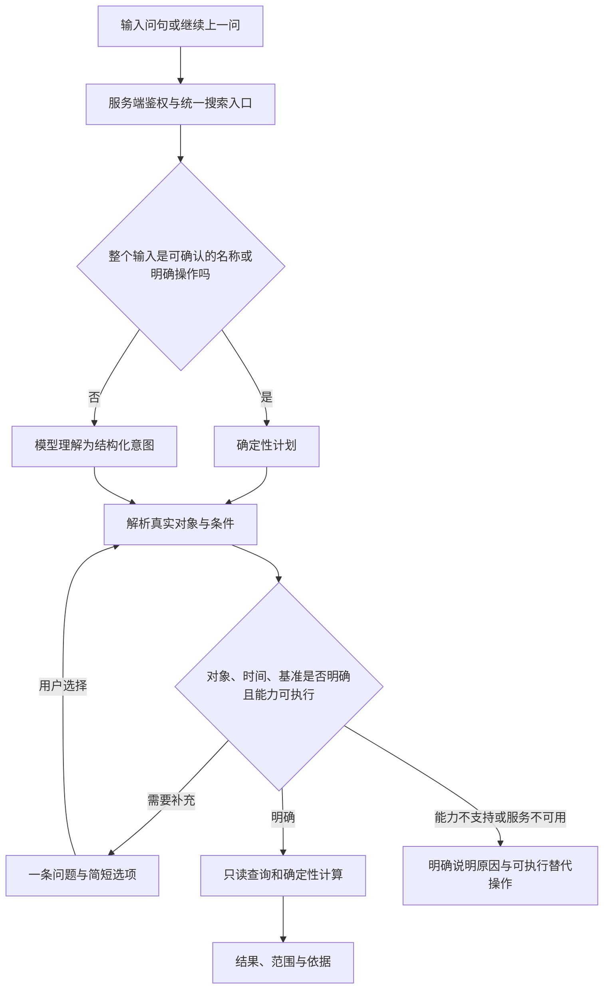

# 站内自然语言搜索重设计

日期：2026-10-15。状态：设计已承接实施，本地实现及离线验收完成；真实模型、微信及发布尚未验收。实施证据见 [V2 验收记录](../../verification/2026-10-15-natural-language-search-v2.md)。下文现状调查与设计审阅记录保留原时点。本文替代旧设计中搜索分流、查询协议和结果交互部分，扫描功能沿用现状。

本轮目标是让用户按自己的表达查已有数据，而不是记住系统支持的句式。约束继续有效：不启动微信开发者工具、不使用游客 AppID、不新增或修改单元测试、不自行部署或请求生产 API、不提交或推送；不放宽已有权限、开关或免费额度保护。

## 1. 已确认事实与本次判断

用户确认：同一宝宝下，“左卡尼丁”和“左卡”都能搜到药物，“左卡摄入频次”搜不到。这已经排除了该案例中“药物完全未加入检索”和“简称完全不能命中”两种解释。

本地实际代码核对：

- `repository.js` 已包含 `medications`，按当前宝宝读取；属性值也已接入。
- “左卡摄入频率”“左卡服用频次”“左卡一天几次”能生成同一字段计划；“左卡摄入频次”本地属性解析返回未识别，转入模型路径。因此句式变化实际改变了执行路径。未读取用户环境的模型响应，不能据此断言是哪一个线上配置或模型错误。
- 使用合成的“左卡尼丁”资料调用实际查询处理器，全名、简称和已识别属性计划都可命中。这是本地链路证据，不等于用户实机问题已修复。
- 另对 26 个问句调用实际页面控制器，仅观察分流、没有访问模型或生产库，发现“有没有蛋白质少于十克的菜”被当成属性读取，“上周天然蛋白比这周多吗”丢失比较含义，“圣元冲好以后100毫升多少蛋白”被当成食物名称属性查询。
- 系数由前端独立解析并计算，而模型查询协议没有系数序列、均值和比较操作。即使模型理解了另一种系数表达，也没有统一执行能力。
- 当前只把 `ai.available` 带到页面，配置、额度、解析、对象匹配和字段缺失没有完整呈现为不同故障；现有离线模拟模型检查不能代表真实模型效果。

结论：应重构搜索的理解和执行边界，停止按用户报出的每句话增加优先分支。前面的修正保留为现状证据，不作为新设计已验收的依据。

## 2. 目标行为与范围

用户说“查什么对象、看什么内容、哪段时间”，系统理解后直接查站内数据；必要时用一次简短选择补充当前最关键的信息。用户不必选择“智能模式”，也不必换成完整药名或标准字段名。

本次设计覆盖当前已涉及的功能入口、食物、奶粉、食谱、药物资料，以及饮食、喂奶、服药、喝水记录；包含实际摄入系数、明确的统计与时间比较。喝水记录和汇总能力在本稿中作为设计推荐纳入，不能标成此前已实现。

不接入互联网知识、项目文档、报告全文或通用聊天。查询保存的用药设置和记录，不生成推荐剂量、停药或疗效判断。不引入向量数据库、训练模型或无限循环的自主工具调用。

### 2.1 可执行能力

| 能力 | 输入含义 | 结果 |
| --- | --- | --- |
| `catalog.search` | 名称、类别、我的/系统、明确营养条件 | 有来源标签的资料列表 |
| `catalog.read` | 对象及已保存属性，例如频率、剂量、营养、配料 | 直接回答字段，可打开资料 |
| `records.list` | 记录类型、对象、时间、当时快照条件 | 明细或最近一次事件；可返回本次喂奶的组分 |
| `records.aggregate` | 次数、同单位总用量、记录奶量、饮水量、实际营养摄入 | 数值、单位、日期、记录覆盖情况 |
| `metrics.series` | 实际天然/特殊/总蛋白或热量系数，按日查看 | 日期序列及缺失原因 |
| `metrics.aggregate` | 上述指标明确的日均、最小、最大 | 数值及有效天数 |
| `metrics.compare` | 同一指标、同一单位、两段日期、同一统计方式 | 两段数值和客观差值 |
| `feature.open` | 打开、记录、添加等功能入口意图 | 现有可访问入口；搜索不直接代写记录 |

每项能力必须有注册定义：允许的对象/指标、单位、必要条件、执行器、返回形态、预算和缺失规则。模型提示、计划校验、界面条件选项与执行器从同一注册表派生，禁止出现“提示允许但后端不能执行”的能力。

首批指标注册键固定为：

- 资料属性：`medication.frequency/dosage/concentration/notes`、`nutrition.calories/protein/fat/carbs/fiber/sodium`、`recipe.ingredients`。
- 记录数值：`records.count`、`medication.amount`、`milk.recorded_volume`、`milk.consumed_volume`、`water.volume`、`intake.natural_protein/special_protein/protein/calories/fat/carbs`；`milk.components` 是记录字段投影，只用于最近一次/明细，不参与求和。
- 实际系数：`metrics.natural_protein_coefficient/special_protein_coefficient/total_protein_coefficient/calorie_coefficient`。
- `metrics.series/aggregate` 用上述实际系数，`metrics.compare` 可比较上述记录数值或实际系数，但左右必须同指标、同对象和同维单位。记录数仅计数；用量/体积/摄入支持求和与按有效记录日求日均；系数不支持跨日求和。
- `records.list` 的领域限饮食、喂奶、服药、饮水，`catalog` 的领域限食物、奶粉、食谱、药物。`feature.open` 使用已有功能注册表，入口可访问性仍由服务端权限决定。

## 3. 总体链路



前端只管理输入、展示、选择与请求轮次。移除由 `parseMetricQuery → parseAttributeQuery → parseCatalogQuery → 触发词 → 模型` 决定业务含义的串联分流；资料、记录和系数统一经过服务端编排。未被完全理解的句子不再作为整句名称去查。

名称快速路径只有两个入口：完整输入可确认地匹配真实名称/已保存别名；或用户明确使用分类、来源和筛选控件。纯名称未精确命中也可给候选名称列表，但不能把否定、比较、日期或问句吞进关键词后当成已理解。规则若承担自然语言优化，只能接受完整消费语义的语法，存在未处理的有意义内容就退给模型；不维护不断扩大的“是否需要智能”触发词表。

## 4. 理解协议与对象识别

### 4.1 两种计划，分清职责

模型输出 `IntentDraft`：操作、领域、原始对象提及、属性/指标、配置或实际记录、时间表达、筛选、逻辑关系、待补条件。它不能指定数据库集合、查询语句、用户身份、真实对象 ID 或答案数值。

服务端把草稿编译为 `ResolvedPlan`：协议版本、能力版本、操作、鉴权后的宝宝、解析出的真实 ID、明确时间区间、单位/比较基准、条件、排序/分组、数据质量要求和解释来源。只有这份计划可以执行。

关键字段规范：

- `operation` 使用第 2.1 节固定枚举；`domain` 限功能、食物、奶粉、食谱、药物、饮食、喂奶、饮水、实际营养。
- `entityMentions` 保留用户原文；对象 ID 仅由服务端解析。`subjectMode` 区分 `configured` 与 `observed`。
- `measure` 从能力注册表选择；`periods` 为 0、1 或 2 段显式日期；`aggregation` 仅允许注册的 `count/sum/mean_daily/min/max/latest`。
- `groupBy` 限 `none/day/entity/unit`；“吃过哪些”按历史快照对象去重展示，“分别多少”按实体分组，不用当前资料合并历史不同对象。
- 条件保存属性、运算、数值、单位、基准和来源文本片段；来源为原句、有效上下文、界面选择或已声明默认值。
- 首次版本支持最多六条同时满足的比较/精确排除条件。识别出 OR、嵌套或尚未注册逻辑必须显式返回不支持，不能改成 AND 或删掉否定。
- `unresolved` 由模型报告，再由编译器检查必需项、数值、日期、单位、否定和已识别的比较关系。模型自报“理解完整”不构成正确性的证明，仍需真实模型语料验收。

“左卡摄入频次”的目标计划如下，示例对象 ID 仅表示服务端解析结果，不写进提示或词表：

```json
{
  "schemaVersion": 2,
  "operation": "catalog.read",
  "domain": "medication",
  "entityMentions": ["左卡"],
  "entityIds": ["example-medication-id"],
  "subjectMode": "configured",
  "measure": "medication.frequency",
  "periods": [],
  "filters": []
}
```

“频率／频次／一天几次／隔多久一次”在同一业务语义下都指向该属性；不是分别维护四种专用查询。如果用户明确说“最近一周实际吃了几次”，则编译为服药记录计数，不读配置替代。

### 4.2 实体解析

解析次序：用户已选对象 ID → 完整名称 → 已保存别名 → 可验证的唯一前缀/包含名称候选。候选必须来自当前有权限的数据，附真实 ID、名称、类型和来源。品牌/系列只帮助奶粉等资料定位，不用备注中的另一种药名确认对象。

“左卡”可召回实际保存的“左卡尼丁”；不要求存在预先写死的“左卡→左卡尼丁”映射。用户保存的是“丁”，就显示原始名称“丁”，不自动纠正为另一个药名。“左卡尼汀”与“左卡尼丁”这种近似拼写只能作为候选提示；没有已保存别名或用户选择时，不静默认定为同一个对象。

- 名称检索允许多候选列表。
- 简单属性读取可按真实名称分别展示多条，不合并数值。
- 统计或上次记录需要唯一对象时，先问“你指哪一种？”并列出现有名称；用户明确说“分别”才按对象分组。
- 没有当前药物资料但存在服药记录时，记录查询仍可从权限内的历史名称/ID 召回，不能把已删除资料当成没有历史。
- 无候选返回“没找到这个名称”，不是“没有服用记录”；不擅自用模型知识造出实体。

## 5. 时间、单位与统计口径

| 问法 | 设计默认与反馈 |
| --- | --- |
| 资料名称/已设置频率 | 不加历史日期条件 |
| 记录未写日期 | 近 30 天，在结果上方显示可点改的日期标签 |
| 最近一次、上次 | 查最近一条真实事件，不暗限近 30 天 |
| 最近的摄入系数 | 最近有可用饮食记录的日期，同时显示该日期和缺失情况 |
| 最近一周、近七天 | 含当天的滚动七天，上海时区 |
| 本周、上周、上个月 | 周一开周、完整上周、上个自然月；本周注明截至当前记录 |
| 近期、这几天，且问区间平均或频繁程度 | 有有效上下文则沿用；否则提供近 7 天/近 30 天等选择，不猜隐含时间 |
| 上周比这周多吗，未说明总量还是日均 | 只问比较总量还是日均；结果显示两段实际日期与覆盖情况 |

“左卡摄入频次”未带日期时先答已设置频率，并提供轻量“看实际服用记录”操作，不为一个明确的属性读取强制追问。明确的实际频次回答记录次数和有记录天数；未记录不等于实际没吃，不推断依从性或漏服。

确定性计算要求：

1. 历史营养用当时食用快照，不套用当前食物/奶粉库的新值；沿用现有新旧记录去重、剩奶折算及蛋白分类口径。
2. 实际摄入系数按各日实际摄入与有效体重计算，不能拿设置的目标系数回答。历史体重沿用现有有效体重规则，并携带体重来源日期；缺体重不输出零。
3. 区间日均是有效日期的日指标算术平均，同时返回有效天数/请求天数；没有记录或缺依据的日期不自动补零。真实、可验证的零保留为零。比较使用同一指标和统计方式；零基数不输出无穷百分比。
4. 用药计数按记录 ID 去重；用量求和按药物 ID 和可转换的同维单位分组。g/mg 可按固定比例换算；ml 与 mg 不用当前药物浓度跨历史换算。混合且不可转换的单位分别显示，不能给一个总数。
5. 食物营养比较默认每 100 克并显示基准。奶粉须区分干粉和冲调液；缺冲调依据时返回缺数据，不用模型猜浓度或用干粉值充数。
6. 普通“喝了多少奶”先回答现有当日统计口径的“已记录奶量”，在依据中说明口径。现有 `nutritionSummary.totalVolume` 会累加奶粉组分的 `waterVolume`，不能直接改称成品实际入口毫升。明确问实际喝完的成品量时，使用 `consumedBottleVolume` 等有依据的实际记录；缺少实际体积的记录保留未知，不能混合冲配水量补齐。
7. 饮水量用 `volumeMl/volume`，不把配奶用水或治疗液体静默算进独立饮水量。实际营养能量保留现有治疗营养计入口径。
8. “不含奶的食谱”不能用名称排除代替完整配料判断。配料完整且排除对象可确定才执行；“奶”所指范围不明确时问牛奶/奶粉还是乳制品。缺配料完整性或可靠分组数据时说明无法确认，不能声称无奶。

## 6. 补充条件与连续查询

结果页保持单屏搜索，不做冗长聊天。状态包括：理解中、需要选择、查询中、有结果、没有匹配对象、没有记录、缺少数据、查询未完成、能力不支持、服务不可用。用户能看出失败发生在哪一步。

每次只询问当前最关键的一项，顺序为对象 → 配置/实际等会改变问题含义的选择 → 日期 → 比较基准/阈值。已清楚的信息全部保留，不把用户送去重新填写整个筛选表。某选择解开问题后自动继续；需要下一项时再显示下一问。

- 奶粉：“按干粉还是冲调液？”两个按钮。
- 同名药物：“你指哪一种？”列真实名称。
- 模糊“低蛋白”：询问每 100 克低于多少克；不自行给医疗阈值。
- 追问“换成上个月”：沿用上一项对象、指标和统计方式，只改时间。
- “那另一种呢”：上文刚给出两个明确候选才切换；否则给选择，不猜对象。
- 每个补充项有挑战 ID 与选项 ID，绑定原计划版本；不信任客户端提交的任意药物 ID 或候选文字。

上下文保存在已有 `search_query_sessions` 的独立 `context` 类型记录，按文档 ID 读取，最多保留最近六轮已确认的语义状态，30 分钟过期；不用全量医疗记录充当聊天上下文。令牌签名绑定账号、宝宝、上下文版本与有效期，签名用途与翻页游标区分。切换宝宝、账号、权限变化、编辑新主题时废弃旧上下文；客户端编辑期间迟到响应不能覆盖新输入。

## 7. 接口与前后端职责

统一入口仍放在 `searchManager`。新前端只发一次 `action: search`，包含 `requestId`、`babyUid`、原句及可选上下文令牌、选择回执或受限条件编辑。翻页携带同一计划绑定的游标，不重新调用模型。

服务端内部顺序：鉴权 → 读取可用能力与版本 → 明确输入快速解析/模型理解 → 解析实体 → 编译与补问 → 只读执行 → 生成结构化结果。前端传入分类仅作为界面上下文；自然语言明确要求药物或记录时，以本次问题为准，不受上次停留的食物分类限制。手动筛选则是明确的用户约束。

响应包含：`status`、`planId`、`contextToken`、`result.kind`、数据、日期与单位、可编辑条件、下一次选择、数据覆盖情况、依据定位和安全诊断 ID。结果形态限定为列表、单值、日期序列、比较、功能入口。客户端不再根据某个意图字符串推断它只能显示在“饮食记录”中。

`capabilities` 返回协议/能力/构建版本、模型是否就绪和明确原因、允许操作。服务端重新检查当前额度，不能仅依赖页面打开时缓存的 `aiAvailable`。支持与否以实际可调用的能力注册为准，不能只宣传模型支持。

执行器只读业务集合。现有搜索会话与调用额度可写；不得调用会自动创建成长记录或回写汇总的普通读取路径。既有服务端 `rebuildDailySummaryV2` 的写回入口和简化加载不能直接当成搜索服务，需提取/共用规范化与纯计算，并补齐当前客户端只读链路的新旧记录、有效体重和营养口径。

## 8. 简洁结果与失败恢复

- 名称列表：名称为主，短摘要，醒目的“我的／系统”标签。
- 属性答案：先显示所问字段，例如“已设置频率：每日 2 次”；剂量、浓度不在未询问时堆满页面。
- 统计答案：大数值、单位、实际日期和必要的覆盖标识；明细与计算依据折叠，能打开原记录。
- 系数与比较：默认显示直接回答和日期数据；多日期时可展开序列，缺数据的日期明确留空并给原因。
- 首屏不恢复介绍大标题、功能说明、冗长示例卡和常驻高级筛选。
- 语义服务未就绪：“智能解析暂不可用，仍可按名称查询”；对象没找到、对象存在但无记录、字段没填、计算条件缺失分别表述。
- 模型格式错误允许一次受预算限制的格式修复；语义冲突必须补问。仍失败时保留原句和已确认条件，不显示内部协议错误，也不让用户猜需要换哪个句式。

## 9. 模型、预算与可诊断性

模型仍只把自然语言转成受限意图，权限、对象 ID、单位、日期、数学和答案均由代码决定。模型只接收本句、必要的已确认语义和能力定义；不把全量私有药物库/病史发送给模型。复杂实体解析由服务端执行。

一次提交最多一次主要模型理解、一次有剩余预算的格式修复，不进行开放式循环；两次共享模型总预算 10 秒。整个编排预算 22 秒，客户端 25 秒超时；预算耗尽返回可恢复状态。沿用模型白名单、免费额度停止条件、场景额度与幂等请求，不自行切换收费模型或取消限额。

工程初始预算：名称/明细每页 20 条；区间汇总最多 90 天、比较每段最多 90 天，共享最多 5000 条原始记录读取预算。具体阈值属本稿设计建议，应以验收数据校准。超限返回需要缩短范围，不能把第一页或前七个日期的合计说成全区间结果；本版不做跨页累加后冒充最终完整统计。支持列表继续翻页。

结果带查询时点、来源版本和质量状态。能使用已有修订号时校验修订号，否则校验范围内源数量/最新更新时间等变化标记；读取期间观察到变化就重试或返回未完成，不声称强事务快照。缺失/失败来源不允许输出完整总计。

每次查询记录诊断阶段、路由、操作、候选数量、所选实体匹配方式、必要条件缺口、模型/执行耗时、错误类别、前后端构建版本。默认不记录原句、完整药名、个人记录或模型原文；人工授权排障时才导出脱敏详情。

必须能区分：未进模型、模型不可用、模型格式错、意图无法执行、实体未匹配、字段不存在、无记录、数据不完整、版本不一致。用诊断 ID 关联前后端阶段，避免下次“左卡摄入频次”失败时继续猜简称或部署。

## 10. 验收与真实模型要求

共 60 条[人工验收语料](../../examples/search-v2-acceptance.zh-CN.json)，包括用户原句、同义句、上下文追问、缺数据、权限与服务失败；[当前分流基线](../../verification/2026-10-15-search-routing-baseline.json)记录 26 个问句的实际页面分流及“频次”专项复现。语料是人工验收材料，不新增单元测试；不得只在被硬编码的三个例句上宣告成功。

核心验收组必须同时通过：

1. “左卡尼丁／左卡／左卡摄入频率／左卡摄入频次／左卡一天几次”使用同一份真实药物资料；除名称列表外，语义一致的属性问法最终必须解析到同一个 ID 和字段。
2. 中文数字、日期同义表达、每 100 克与冲调液基准不改变用户要求。
3. 同一问题换表达，不因规则或模型路径不同而改变业务答案；不能把次数变成配置频率，也不能把均值/比较变成明细列表。
4. 无体重、无记录、真实零、历史字段缺失、混合单位、跨宝宝、源读取失败各有正确状态；部分结果不得冒充完整统计。
5. 追问只修改指定条件；上下文过期或切换宝宝不得沿用旧对象。

验收分四层记账：当前分流基线、执行器与口径、真实模型语义、合法 AppID 下的用户验收。前两层通过不等于后两层通过。真实模型需要在同一实际模型、能力版本与配置下运行，至少三轮重复，按实体/操作/时间/单位/条件是否正确统计；不能用模拟模型响应代替。目标：全部核心组与权限/数值红线 100% 正确，支持范围内语义成功率至少 95%；误解后给出看似正确答案视为失败，合理补问单独计数。

本轮没有请求真实模型、读取生产配置或启动微信工具，因此这些目标尚未取得实际成绩。

## 11. 实施边界与顺序

这是一个连贯改造，建议由主代理连续实施并最后独立审查，不拆成相互不知道语义约定的多个功能项目。实现前先确认本稿覆盖的能力和交互，不再单独修“摄入频次”正则作为完成标志。

1. 建立版本 2 协议、能力注册与统一结果状态；先用当前失败句的实际路由作为基线。
2. 建立服务端编排、真实对象解析与补充条件，接通已有名称/属性能力；删除前端语义分流的业务职责。
3. 把只读资料、事件、实际指标及其均值/比较接到注册表；共用营养与日期口径，禁止复制出另一套系数算法。
4. 接通简洁结果、可点改条件和短上下文追问，完成权限隔离及迟到请求处理。
5. 运行已有检查、编译、严格小程序模块引用检查与人工验收语料，再独立检查完整链路；真实模型和微信验收单独列证据。

主要文件职责：`packages/search-core` 维护版本 2 协议、能力/结果定义、日期和纯计算接口；`searchManager` 新增 `orchestrator/entityResolver/planCompiler/contextRepository/recordQueryService/metricQueryService`，复用现有访问校验、资料适配、游标与模型请求；`miniprogram/utils/searchService.js` 仅负责接口；搜索页仅负责交互与结构化结果；`searchMetrics.js` 的前端语义路由退出主链路。每日记录与报告只提取可共用的纯函数，不在搜索中改写原业务流程。构建脚本同步全部共享产物，使用明确文件路径，继续防止微信目录 require 缺模块。

发布前先核实当前线上前后端版本，生成同一批次的版本号、云函数与小程序包清单及可恢复快照。新客户端必须校验服务端协议，不以本地代码通过推断线上生效；不得一次性删除仍被已发布客户端使用的入口。旧入口仅在发布窗口需要时保留，确认旧客户端不再依赖后清理，不保留长期双轨分流。实际部署、配置变更或清理仍需用户授权。

## 12. 本轮交付记录

本轮交付设计、人工验收语料和当前分流基线。尚未改动业务代码、部署或宣称原实机问题修复。

独立审阅已经按“另一位工程师能否据此制定实施计划”的标准完成，结论为“没有重要遗留问题”。这仅表示设计可进入实施计划阶段，不表示业务已实现或线上已验收。

实施更新：用户已授权并完成本地业务改造；第 12 节描述的是此前设计交付时点。本轮实施、独立审查修复和未执行验收项以 [V2 验收记录](../../verification/2026-10-15-natural-language-search-v2.md) 为准。

## 2026-10-16 理解入口修正

用户继续反馈问句前缀导致路由变化，并明确质疑句式优先。现调整为：可验证的完整名称直查，完整自然问句原样优先交模型理解；句式规则只在模型不可用、且能完整确认意图时作有标识的降级。手动控件、已确认上下文和计算仍由代码处理。此前确定性语法优化的描述以此优先级为准。证据见 [模型优先修正记录](../../verification/2026-10-16-search-semantic-first.md)。真实模型与微信验收仍未执行。
